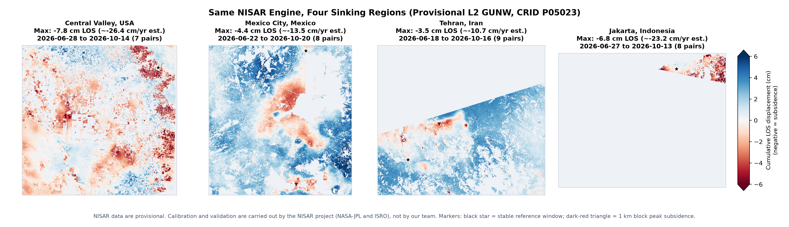

# Where the Ground Is Sinking Fastest in 2026

> **Calibration Notice:** *NISAR data are provisional. Calibration and validation are carried out by the NISAR project (NASA-JPL and ISRO), not by our team.*

*Figure 1. Standardized 108–120 day cumulative displacement maps across subsiding basins in 2026. Data: NASA-ISRO NISAR via ASF DAAC. Analysis: Team Aseltech.*

When groundwater is pumped faster than rain recharges it, deep fine-grained silt and clay layers compact like a deflating sponge. Over weeks and months, this silent compaction lowers the ground by centimeters, cracking aqueducts, damaging buildings, and tilting gravity canals. In summer 2026, the newly operational NASA–ISRO Synthetic Aperture Radar (NISAR) satellite began systematic observations of Earth's land surface. Using its long-wavelength (24 cm) L-band radar, NISAR peered through haze and agricultural canopies to map ground motion across entire valleys at unprecedented detail. High school researchers at ASELSAN Vocational and Technical Anatolian High School (Team Aseltech) built an open-source pipeline to compare these sinking regions under a standardized benchmark: the 2026 Global Subsidence Atlas.

Globally, the fastest verified subsidence concentrates in arid agricultural plains and historic lakebed cities where water extraction exceeds recharge. In California's southern San Joaquin Valley, intensive irrigation pumping caused the valley floor to sink by up to 7.8 cm in line of sight (LOS)—equivalent to 7.22 cm per 100 days, or 10.1 cm vertical estimate—over 108 days (June 28–October 14, 2026). Independent measurements from 10 continuous Nevada Geodetic Laboratory GPS stations confirm these satellite estimates with a median difference of just 1.00 cm (r = 0.924). More than 230 km² of farmland sank by over 5 cm, tilting critical water corridors including the Tulare Irrigation District Canal (57.01 mm/km) and the California Aqueduct (49.12 mm/km).

Similar land compaction appears thousands of kilometers away. In Mexico City, built on soft ancient lakebed clays, an 8-pair provisional NISAR chain recorded 7.0 cm of LOS subsidence (5.80 cm per 100 days; 9.7 cm vertical est.) over 120 days when referenced to the stable volcanic margin southwest of the basin. Across the pistachio plains of Rafsanjan, Iran, deep well pumping lowered the ground by 5.8 cm LOS (4.83 cm per 100 days) across a 10-pair summer chain. Preliminary readings in Türkiye's Konya Closed Basin (-9.6 cm LOS) and northeast Iran's Mashhad Valley (-8.6 cm LOS) indicate even faster localized compaction, pending expanded reference grids. By placing diverse basins on one uniform metric—centimeters per 100 days—NISAR transforms local groundwater stress into globally comparable planetary vital signs.

---

*Story by Team Aseltech, Ankara, Türkiye. Data courtesy NASA-ISRO NISAR via ASF DAAC, Nevada Geodetic Laboratory, and OpenStreetMap.*
