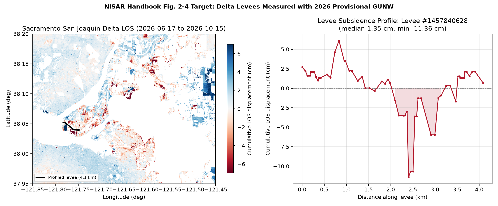

# Sacramento–San Joaquin Delta Levees (NISAR Handbook Fig. 2-4 Target)

In Section 2.4 (Figure 2-4) of the NISAR Science Users' Handbook, the Sacramento–San Joaquin Delta levee network is highlighted as a flagship target for monitoring ground deformation. Here we measured that exact target using 9 consecutive provisional NISAR L2 GUNW pairs (Path 42 Descending, Frame 69) from `2026-06-17` to `2026-10-15` (120 days, `CRID P05023`). Across the Delta study box (`-121.85, 37.95, -121.45, 38.20`), the 1 km block-median peak cumulative subsidence reaches `-1.3 cm` LOS (reference sensitivity range `-1.3` to `-1.1 cm`; approximately `-1.6 cm` vertical at 35.8° incidence), while localized samples along OpenStreetMap levee/embankment alignments (`N = 87` points; 10th percentile `-3.48 cm` LOS, reaching `-11.36 cm` on a 4.09 km segment) highlight reaches that warrant closer inspection.

**Physical drivers:** Subsidence in the Delta is driven by microbial oxidation and drainage-induced compaction of drained organic peat soils combined with groundwater and agricultural drainage pumping, which gradually lowers island interiors and stresses surrounding earthen embankments.

**Actionable insight:** Levee and reclamation district managers should use these spaceborne deformation gradients to prioritize field geotechnical inspections, piezometer checks, and crest re-leveling on the fastest-subsiding levee segments rather than relying solely on uniform visual patrols.

**Alignment with NASA NISAR Resources:** As summarized in the [NISAR Levees and Dams White Paper](https://assets.science.nasa.gov/content/dam/science/missions/nisar/nisar-jpl/pdf/NISAR_Applications_Levees_and_Dams1.pdf) ([NISAR Societal Benefits](https://science.nasa.gov/mission/nisar/societal-benefits/)), conventional levee safety checks depend heavily on periodic visual or in-situ surveys that can miss gradual settlement; spaceborne L-band SAR provides repeatable early-warning coverage across vegetated and marshy corridors. This analysis extends NASA's [Land Subsidence StoryMap](https://storymaps.arcgis.com/stories/109e602e748346f3be8dc89124619828) (Peacock, A., An, K., Pinto, N., & Lou, Y., 2024, Zenodo, https://doi.org/10.5281/zenodo.10818833) from airborne California case studies into the 2026 provisional NISAR era.
