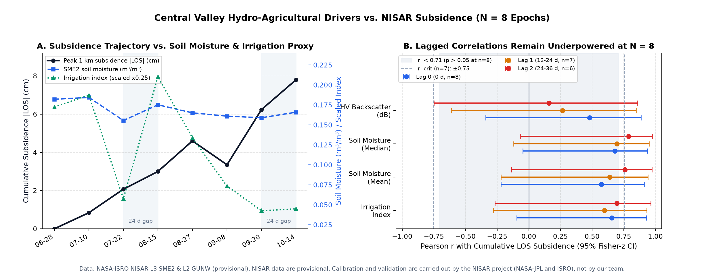

# Central Valley Hidro-Tarımsal Sürücü ve Gecikmeli Korelasyon Analizi (`N = 8` Epok Sınırı)

**İncelenen dönem:** `2026-06-28 – 2026-10-14` (`108` gün, `8` NISAR L3 SME2 + L2 GUNW epoku; `data/central_valley/drivers.json`)  
**Üretici kod ve test:** [`analysis/pc5/drivers_analysis.py`](../../analysis/pc5/drivers_analysis.py) · [`analysis/pc5/test_drivers_analysis.py`](../../analysis/pc5/test_drivers_analysis.py)  
**Kalibrasyon uyarısı:** *NISAR data are provisional. Calibration and validation are carried out by the NISAR project (NASA-JPL and ISRO), not by our team.*

---

## 1. İstatistiksel Güç ve Tasarım Kısıtları (`N = 8` Epok)

Mevcut zaman serisi yalnızca **8** kazanım tarihi içermektedir (`2026-06-28`, `07-10`, `07-22`, `08-15`, `08-27`, `09-08`, `09-20`, `10-14`). Kazanımlar arası aralıklar `12, 12, 24, 12, 12, 12, 24` gündür (`07-22..08-15` ve `09-20..10-14` arasında iki adet `24` günlük boşluk bulunur).

- **Anlamlılık eşikleri ($\alpha = 0.05$, çift taraflı Student-$t$):**
  - **Lag 0 (`n = 8`, `df = 6`):** $|r_{\text{krit}}| = \mathbf{0.707}$
  - **Lag 1 (`12–24` gün, `n = 7`, `df = 5`):** $|r_{\text{krit}}| = \mathbf{0.754}$
  - **Lag 2 (`24–36` gün, `n = 6`, `df = 4`):** $|r_{\text{krit}}| = \mathbf{0.811}$
- **%80 istatistiksel güç alt sınırı (`n = 8`, $\alpha = 0.05$):** Minimum saptanabilir etki büyüklüğü **$|r| \ge 0.849$** düzeyindedir. Orta-güçlü (`|r| = 0.50–0.65`) gerçek ilişkiler bile bu örneklem boyutunda $\alpha = 0.05$ altında istatistiksel olarak ayırt edilemez.
- **Kesin permütasyon testi:** $n \le 8$ olduğundan ($8! = 40{,}320$, $7! = 5{,}040$, $6! = 720$) rastgele örnekleme yerine **tüm olası permütasyonlar** eksiksiz hesaplanmıştır.

---

## 2. Kümülatif Çökme (`subsidence_cm`) ile Gecikmeli Korelasyon Tablosu

Not: `drivers.json` içinde yaz sonunda toprak nemi (`0.184 → 0.159 m³/m³`) ve sulama indeksi (`0.749 → 0.180`) düşerken kümülatif çökme derinleştiği (`0.0 → -7.80 cm`) için pozitif Pearson $r$, daha kuru geç yaz yüzey koşullarının daha derin kümülatif çökmeyle eşzamanlı görülmesini yansıtır.

| Sürücü değişkeni | Gecikme (`lag`) | $n$ | Pearson $r$ | %95 Fisher-$z$ GA | Student-$t$ $p$ | Kesin perm. $p$ | Spearman $\rho$ (`p_perm`) | $\alpha = 0.05$ anlamlı mı? |
|---|---|---:|---:|---:|---:|---:|---:|---|
| **Ortalama toprak nemi (`soil_moisture`)** | `lag 0` (`0 g`) | 8 | **0.573** | [-0.22, 0.91] | 0.137 | 0.140 | 0.452 (`0.267`) | Hayır |
| **Ortalama toprak nemi (`soil_moisture`)** | `lag 1` (`12–24 g`) | 7 | **0.638** | [-0.22, 0.94] | 0.123 | 0.130 | 0.571 (`0.200`) | Hayır |
| **Ortalama toprak nemi (`soil_moisture`)** | `lag 2` (`24–36 g`) | 6 | **0.759** | [-0.14, 0.97] | 0.080 | 0.089 | 0.771 (`0.103`) | Hayır |
| **Medyan toprak nemi (`soil_moisture_median`)** | `lag 0` (`0 g`) | 8 | **0.681** | [-0.05, 0.94] | 0.063 | 0.066 | 0.479 (`0.233`) | Hayır |
| **Medyan toprak nemi (`soil_moisture_median`)** | `lag 1` (`12–24 g`) | 7 | **0.696** | [-0.12, 0.95] | 0.082 | 0.086 | 0.571 (`0.200`) | Hayır |
| **Medyan toprak nemi (`soil_moisture_median`)** | `lag 2` (`24–36 g`) | 6 | **0.788** | [-0.07, 0.98] | 0.063 | 0.078 | 0.771 (`0.103`) | Hayır |
| **Sulama indeksi (`irrigation_index`)** | `lag 0` (`0 g`) | 8 | **0.654** | [-0.09, 0.93] | 0.079 | 0.088 | 0.667 (`0.083`) | Hayır |
| **Sulama indeksi (`irrigation_index`)** | `lag 1` (`12–24 g`) | 7 | **0.599** | [-0.28, 0.93] | 0.156 | 0.161 | 0.464 (`0.302`) | Hayır |
| **Sulama indeksi (`irrigation_index`)** | `lag 2` (`24–36 g`) | 6 | **0.695** | [-0.27, 0.96] | 0.126 | 0.143 | 0.600 (`0.242`) | Hayır |
| **HV geri saçılımı (`hv_backscatter_db`)** | `lag 0` (`0 g`) | 8 | **0.480** | [-0.34, 0.89] | 0.229 | 0.229 | 0.476 (`0.243`) | Hayır |
| **HV geri saçılımı (`hv_backscatter_db`)** | `lag 1` (`12–24 g`) | 7 | **0.265** | [-0.61, 0.85] | 0.566 | 0.578 | 0.321 (`0.498`) | Hayır |
| **HV geri saçılımı (`hv_backscatter_db`)** | `lag 2` (`24–36 g`) | 6 | **0.160** | [-0.75, 0.86] | 0.762 | 0.775 | 0.143 (`0.803`) | Hayır |

- `drivers.json` içinde yer alan üç ön korelasyon (`0.573`, `0.654`, `0.638`) bire bir doğrulanmıştır; ancak tamamı `p = 0.08–0.16` aralığında kaldığı ve %95 Fisher-$z$ güven aralıkları sıfırı kapsadığı için $\alpha = 0.05$ düzeyinde anlamlı değildir.
- Bölgesel ilk-5 sıcak nokta ortalaması (`subsidence_top5_mean_cm`) duyarlılık testinde de yalnızca bir alt kombinasyon (`soil_moisture_median` `lag 2`, `n = 6`: $r = 0.855$, `p_perm = 0.046`; ancak sıra korelasyonu $\rho = 0.600$, `p_perm = 0.242`) sınırda `< 0.05` görünmektedir; 12 çoklu sınama için Bonferroni eşiği ($\alpha / 12 = 0.0042$) altında bu sonuç da rastgele oynamadan ayrılamaz.

---

## 3. Trendden Arındırılmış Aralık Hızı (`cm/gün`, `n = 7` aralık) Testi

Kümülatif `subsidence_cm` eğrisi yaz boyunca tekdüze aşağı doğru biriktiği için mevsimsel olarak azalan değişkenlerle sahte korelasyon (`spurious trend correlation`) riski taşır. Epoklar arası günlük çökme hızı ($\Delta d / \Delta t$, `7` aralıkta `-0.241` ile `+0.104 cm/gün` arası) incelendiğinde tüm eşzamanlı ilişkiler sıfıra iner:

- **Aralık ortası ortalama toprak nemi vs. hız (`n = 7`):** $r = 0.037$, kesin permütasyon $p = 0.930$ ($\rho = -0.036$)
- **Aralık ortası medyan toprak nemi vs. hız (`n = 7`):** $r = 0.008$, kesin permütasyon $p = 0.981$ ($\rho = 0.000$)
- **Aralık ortası sulama indeksi vs. hız (`n = 7`):** $r = 0.130$, kesin permütasyon $p = 0.809$ ($\rho = -0.071$)
- **Aralık ortası HV geri saçılımı vs. hız (`n = 7`):** $r = 0.174$, kesin permütasyon $p = 0.747$ ($\rho = 0.143$)
- **Bir önceki epok (`lag 1`, `n = 6`) vs. sonraki aralık hızı:** Sulama indeksi $r = 0.521$ (`p_perm = 0.311`), ortalama toprak nemi $r = 0.402$ (`p_perm = 0.447`), HV $r = 0.411$ (`p_perm = 0.399`) — hiçbiri istatistiksel olarak anlamlı değildir.

*Figure 1. Central Valley provisional NISAR cumulative LOS subsidence alongside SME2 soil moisture and irrigation proxy over 8 acquisitions (`2026-06-28` to `2026-10-14`), with exact Fisher-$z$ 95% confidence intervals across lags 0–2 showing why $|r|$ stays below two-sided significance thresholds at `N = 8`. Data: NASA-ISRO NISAR, ASF DAAC. Analysis: Team Taykut.*

---

## 4. Özet Sonuç ve Tam Yıl Gereksinimi

1. `2026-06-28 – 2026-10-14` arasındaki `8` epokluk seride geç yaz yüzey kuruması ve azalan sulama sinyali kümülatif çökmeyle aynı yönde (`r = 0.57–0.79`) değişmektedir, ancak **`N = 8` örneklem büyüklüğü ve trend etkisi nedeniyle hiçbir sürücü $\alpha = 0.05$ düzeyinde nedensel öncü olarak doğrulanamaz**.
2. Trendden arındırılmış 12–24 günlük aralık hızları yalnızca `7` nokta sunmakta ve belirgin bir kısa dönem tepkisi göstermemektedir (`p ≥ 0.31`).
3. Mevsimsel gecikme yapısını ve elastik geri tepme vs. kalıcı akifer sıkışması ayrımını güvenilir biçimde test etmek için en az tam bir hidrolojik döngü (`N ≥ 24–30` epok, Q08 tam yıl serisi) gerekmektedir.
