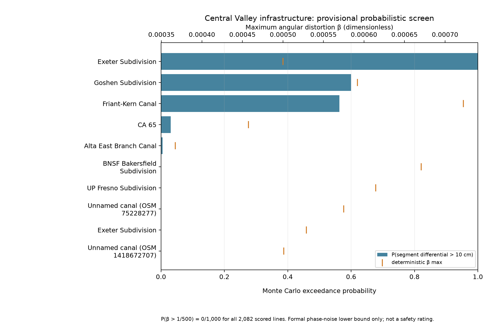

# Probabilistic engineering risk screen — Central Valley (O2)

## Question and data

This is an offline, provisional screen of `risk/central_valley_infra.geojson`: all `3,238` source lines were considered and `2,082` had at least two usable samples within the valid raster footprint. The other `1,156` had no scoreable continuous profile under those criteria. `data/central_valley/assets.json` is used only to compare its existing deterministic top ten with the probabilistic ranking. The displacement grid is `analysis/out/central_valley_cum.npz` (`2026-06-28` to `2026-10-14`, seven provisional pairs). The numerical pixel uncertainty was recomputed in memory from the seven local `pipeline/subset/central_valley/*.npz` pairs with PC5's Cramér–Rao function. The recomputed bbox median is `0.2943 cm` LOS, consistent with the rounded `0.294 cm` in `data/central_valley/uncertainty/meta.json`. No files under PC5's output folder were changed.

## Method

Each OSM line was projected to the raster CRS, sampled every `100 m`, and bilinearly sampled from the cumulative LOS, local incidence-angle, and LOS sigma grids. Under the stated negligible-horizontal-motion assumption, vertical displacement and sigma are `LOS / cos(incidence)`. For each continuous valid line run, angular distortion is `β = |Δs| / L`, with centimetres converted to metres; β is dimensionless. The deterministic `beta_max` is the largest sampled β over `100 m`, `500 m`, and `1 km` baselines. The segment differential is the largest vertical range along a continuous valid run. No window crosses a masked-data gap.

The Monte Carlo uses `1,000` seeded trials. At each sampled point it draws an independent Gaussian error using the PC5 formal sigma, then records the maximum β and segment differential. `p_beta_exceed` reports strict exceedance of `1/500` and `1/1000`; `p_diff_gt_10cm` is the probability that the segment's maximum sampled differential exceeds `10 cm`. `ci90` is the model-conditional 5th–95th percentile interval for beta and differential. The independent-sample assumption is a simplifying approximation; spatially correlated errors are not represented.

## Thresholds and source check

The project O2 brief cites Skempton & MacDonald (1956) and Boscardin & Cording (1989), and gives approximate `1/300–1/500` damage-limit context. The task requested `1/500` and `1/1000` comparison thresholds. The repository's source register does not include full bibliographic records or the original papers for those two threshold claims. Because this run is offline, I could not independently verify the paper details or the applicability of either ratio. Accordingly, both requested ratios are reported as **screening/sensitivity cutoffs only**; `1/1000` is not presented as a published damage limit, and neither is an acceptance or safety criterion.

The California Aqueduct context is supported by the locally registered [USGS Scientific Investigations Report 2018-5144](https://pubs.usgs.gov/publication/sir20185144), which describes historical subsidence along the aqueduct and its effect on freeboard and flow capacity. The registered [KVPR Friant-Kern report](https://www.kvpr.org/environment/2017-08-03/friant-kern-canal-slows-by-60-percent-subsidence-to-blame) describes a historical capacity reduction associated with subsidence. Those are contextual sources, not validation of this short 2026 NISAR measurement.

## Results

All `2,082` scoreable lines had `p(β > 1/500) = 0/1,000` and `p(β > 1/1000) = 0/1,000`; the largest deterministic beta was `0.00072276`, below `1/1000 = 0.001`. Zero observed exceedances means the Monte Carlo estimate is zero at `0.001` resolution; it does not establish zero real-world risk. Five lines had nonzero `p(Δ > 10 cm)`. Exeter Subdivision (`OSM 196530229`) had a maximum sampled differential of `12.564 cm` and `p(Δ > 10 cm) = 1.0` under this model. This is a local vertical-differential screen, not a damage finding. The ranking below sorts by maximum beta-exceedance probability, then `p(Δ > 10 cm)`, then `beta_max`.

| Probabilistic rank | Feature | OSM ID | Existing gradient rank | β max | P(β > 1/500) | P(β > 1/1000) | P(Δ > 10 cm) | Max differential (cm) |
|---:|---|---:|---:|---:|---:|---:|---:|---:|
| 1 | Exeter Subdivision | 196530229 | 3 | 0.00050014 | 0/1000 | 0/1000 | 1.000 | 12.564 |
| 2 | Goshen Subdivision | 198727101 | — | 0.00059202 | 0/1000 | 0/1000 | 0.600 | 9.780 |
| 3 | Friant-Kern Canal | 79497672 | — | 0.00072276 | 0/1000 | 0/1000 | 0.563 | 9.880 |
| 4 | CA 65 | 1028307714 | — | 0.00045730 | 0/1000 | 0/1000 | 0.031 | 8.740 |
| 5 | Alta East Branch Canal | 79591895 | — | 0.00036723 | 0/1000 | 0/1000 | 0.005 | 8.480 |
| 6 | BNSF Bakersfield Subdivision | 641059314 | — | 0.00067052 | 0/1000 | 0/1000 | 0/1000 | 6.710 |
| 7 | UP Fresno Subdivision | 198739870 | — | 0.00061442 | 0/1000 | 0/1000 | 0/1000 | 6.600 |
| 8 | Unnamed canal (OSM 75228277) | 75228277 | — | 0.00057504 | 0/1000 | 0/1000 | 0/1000 | 5.750 |
| 9 | Exeter Subdivision | 196530220 | — | 0.00052884 | 0/1000 | 0/1000 | 0/1000 | 6.740 |
| 10 | Unnamed canal (OSM 1418672707) | 1418672707 | — | 0.00050116 | 0/1000 | 0/1000 | 0/1000 | 5.010 |

Only one OSM ID (`196530229`, Exeter Subdivision) overlaps between the probabilistic inventory's top ten and the existing deterministic shortlist of ten; the latter is a separate, preselected comparison set. The California Aqueduct line in the existing shortlist (OSM `24016778`) ranks 39th across scoreable lines by this screen, versus rank 4 in the existing gradient list. Its sampled differential is `4.557 cm`, `p(Δ > 10 cm) = 0/1,000`, and `p(β > 1/500) = 0/1,000`; its existing gradient index is `49.12 mm/km`. The different rank reflects different metrics, not a measured change in canal capacity.

## Limitations and interpretation

- The uncertainty surface is a formal phase-noise lower bound. Its source calculation excludes atmospheric delay, residual ramps, unwrapping errors, and other spatially correlated errors; the probabilities are therefore conditional on an optimistic error model.
- Samples are treated as independent Gaussian errors, although nearby raster samples can be spatially correlated. The reported probabilities are not calibrated engineering failure probabilities.
- The displacement period is one provisional summer chain, not a long-term rate or seasonal cycle. LOS-to-vertical conversion assumes negligible horizontal motion.
- The canal calculation has no surveyed cross-section, water level, or freeboard observations. Differential settlement is only a freeboard-relevant proxy; actual freeboard loss and flow-capacity impact are not estimated.
- `1,156` of `3,238` source lines could not be scored because two valid profile samples were unavailable within the masked raster footprint. Results do not certify safety, damage, serviceability, or intervention priority.

## Reproduction

Run `python risk/probabilistic_risk.py` to regenerate `data/central_valley/assets_prob.json` and this report's chart. Run `python -m pytest -q risk/test_probabilistic_risk.py` for the known-profile and zero-sigma checks.
