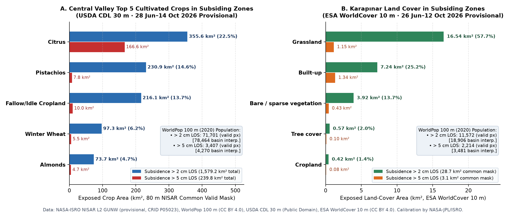

# Population and Crop / Land-Cover Exposure in Subsiding Zones (`docs/story/exposure.md`)

**Owner:** PC8 (`M3hmeT1888`) · **Target:** Website Story / Science Integration (`PC3` `tasks/PC3.md` §16:15 item 6 — Challenge Alignment **B3**)  
**Data Quality Class:** `provisional` (`CRID P05023`, `28 Jun – 14 Oct 2026` Central Valley; `26 Jun – 12 Oct 2026` Karapınar & Konya Closed Basin)  
**Calibration Notice:** *NISAR data are provisional. Calibration and validation are carried out by the NISAR project (NASA-JPL and ISRO), not by our team.*

---

## 1. Plain-English Web Copy (5 Sentences, `docs/REVIEW_1500.md` Compliant)

### Orchards, Grain Fields, and Over 141,000 Residents Sit Inside the 2026 Summer Subsidence Bowls

Combining our 108-day provisional NISAR line-of-sight (`LOS`) displacement maps (`28 Jun – 14 Oct 2026` in California; `26 Jun – 12 Oct 2026` in Türkiye) with **WorldPop 100 m gridded population counts (2020)** shows that an *estimated* **`71,701` residents in California's Central Valley** (`78,464` with `<= 2.5 km` rural basin interpolation; `124,561` on vertical *estimates*) and **`69,854` residents across the broader Konya Closed Basin** (`118,485` with basin interpolation; including **`11,572` residents in the Karapınar core**, `18,906` interpolated) live on land that sank more than **`2 cm` LOS** in a single summer. Within the deepest **`> 5 cm` LOS** subsidence cores (`239.8 km²` in California and `99.5 km²` common-valid area across the Konya Closed Basin), **`3,407` Central Valley residents** (`4,270` interpolated) and **`16,822` Konya Closed Basin residents** (`33,700` interpolated; including **`2,214` in Karapınar**) are directly exposed to rapid ground settlement across towns and rural settlements. Overlaying the **30 m USDA Cropland Data Layer (2021)** in California reveals that **`79.2%` (`1,251.4 km²`)** of the **`1,579.2 km²`** zone subsiding more than `2 cm` LOS—and **`91.2%` (`218.7 km²`)** of the **`> 5 cm` LOS** zone—is active cultivated farmland, led by high-value perennial **citrus (`355.6 km²`)**, **pistachios (`230.9 km²`)**, **fallow or idle cropland (`216.1 km²`)**, **winter wheat (`97.3 km²`)**, and **almonds (`73.7 km²`)** (`grapes` `49.9 km²`, `pomegranates` `37.0 km²`, `alfalfa` `24.6 km²`). Across the **Konya Closed Basin**, **ESA WorldCover 10 m (2021)** shows that coherent pixels sinking more than `2 cm` LOS (`627.2 km²`) cover **semi-arid grassland (`284.91 km²`, `45.4%`)**, **cropland (`173.10 km²`, `27.6%`)**, **bare or sparse vegetation (`127.51 km²`, `20.3%`)**, **built-up town and village fabric (`40.69 km²`, `6.5%`)**, and **tree cover (`0.77 km²`, `0.1%`)**. Within the **`> 5 cm` LOS** Konya core (`99.5 km²` coherent), **cropland becomes the largest single exposed class (`36.28 km²`, `36.5%`)** ahead of **grassland (`32.70 km²`, `32.9%`)**, and across the **`2,157.7 km²`** interpolated `> 2 cm` basin footprint irrigated **cropland rises to `1,167.69 km²` (`54.1%`)** (`24.99 km²` within the `141.1 km²` interpolated Karapınar subset).

---

## 2. Source & License Attribution Line (Required by `tasks/PC8.md` B3)

- **Population Data:** WorldPop Open Population Repository (`WorldPop_Total_Population_100m`, `2020` UN-adjusted 100 m / 3 arc-second gridded population counts, University of Southampton, DOI: [10.5258/SOTON/WP00645](https://doi.org/10.5258/SOTON/WP00645)) — **License: CC BY 4.0**.
- **California Crop Data:** USDA National Agricultural Statistics Service (`NASS`) Cropland Data Layer (`CDL`, `2021`, `30 m` resolution, accessed via [CropScape / Microsoft Planetary Computer STAC](https://www.nass.usda.gov/Research_and_Science/Cropland/SARS1a.php)) — **License: U.S. Public Domain (`17 USC § 105`)**.
- **Türkiye Land-Cover Data:** European Space Agency (`ESA`) WorldCover `10 m` `2021 v200` (Sentinel-1 and Sentinel-2 global land cover, Zanaga et al. 2022, DOI: [10.5281/zenodo.7254221](https://doi.org/10.5281/zenodo.7254221)) — **License: CC BY 4.0**.

---

## 3. Figure & Caption (`docs/REVIEW_1500.md` Format)



**Figure 5.** **Agricultural crop, land-cover, and population exposure inside summer 2026 NISAR subsidence zones (`> 2 cm` and `> 5 cm` LOS).** **A.** Top five cultivated crop types (`km²`) inside the California Central Valley common-valid subsidence footprint (`28 Jun – 14 Oct 2026`, `7` provisional pairs, `1,579.2 km²` with `> 2 cm` LOS sinking in blue and `239.8 km²` with `> 5 cm` LOS sinking in red), derived from the 30 m USDA NASS Cropland Data Layer (`2021`). Callout boxes list estimated exposed population from WorldPop 100 m (`2020`). **B.** Top five land-cover classes (`km²`) inside the Karapınar, Türkiye common-valid subsidence footprint (`26 Jun – 12 Oct 2026`, `8` provisional pairs, `28.7 km²` with `> 2 cm` LOS sinking in green and `3.1 km²` with `> 5 cm` LOS sinking in orange), derived from ESA WorldCover 10 m (`2021 v200`). **C.** Top five land-cover classes (`km²`) across the full Konya Closed Basin common-valid subsidence footprint (`26 Jun – 12 Oct 2026`, `8` Track 7 provisional pairs, `627.2 km²` with `> 2 cm` LOS sinking in teal and `99.5 km²` with `> 5 cm` LOS sinking in magenta), also from ESA WorldCover 10 m (`2021 v200`). *NISAR data are provisional. Calibration and validation are carried out by the NISAR project (NASA-JPL and ISRO), not by our team.* Data: NASA-ISRO NISAR L2 GUNW (ASF DAAC), WorldPop 100 m (CC BY 4.0), USDA CDL 30 m (Public Domain), ESA WorldCover 10 m (CC BY 4.0). Analysis: Team Aseltech.

---

## 4. Summary Tables (`data/central_valley/exposure.json`, `data/karapinar/exposure.json`, `data/konya_plain/exposure.json`)

### 4.1 Population Exposure (`WorldPop 100 m`, `2020`, `estimate`)

| Site & Bounding Box | Total BBox Population | Population on Valid InSAR Pixels | **`> 2 cm` LOS (Valid Pixels)** | **`> 5 cm` LOS (Valid Pixels)** | `> 2 cm` LOS (`<= 2.5 km` Basin Interp.) | `> 5 cm` LOS (`<= 2.5 km` Basin Interp.) | `> 2 cm` Vertical *Estimate* (Valid Pixels) | `> 5 cm` Vertical *Estimate* (Valid Pixels) |
|---|---:|---:|---:|---:|---:|---:|---:|---:|
| **Central Valley, CA** (`[-120.2, 35.6, -119.0, 36.6]`) | `613,429` | `578,449` | **`71,701`** | **`3,407`** | `78,464` | `4,270` | `124,561` | `7,067` |
| **Konya Closed Basin, TR** (`[32.4, 37.4, 33.9, 38.1]`) | `868,371` | `444,542` | **`69,854`** | **`16,822`** | `118,485` | `33,700` | `79,261` | `32,016` |
| *— Karapınar Subset (inside Konya Basin)* (`[33.3, 37.6, 33.8, 37.9]`) | *`47,621`* | *`18,114`* | *`11,572`* | *`2,214`* | *`18,906`* | *`3,481`* | *`13,618`* | *`4,179`* |
| **Combined Two-Basin Total (Central Valley + Konya Basin)** | `1,481,800` | `1,022,991` | **`141,555`** | **`20,229`** | **`196,949`** | **`37,970`** | **`203,822`** | **`39,083`** |

### 4.2 Central Valley Top Cultivated Crops in Subsiding Zones (`USDA CDL 30 m`, `2021`)

| Rank | CDL Code | Crop / Land-Cover Name | Area in `> 2 cm` LOS (`km²`) | Share of `> 2 cm` Zone (`%`) | Area in `> 5 cm` LOS (`km²`) | Share of `> 5 cm` Zone (`%`) |
|---:|---:|---|---:|---:|---:|---:|
| **1** | `72` | **Citrus** | **`355.64`** | `22.5%` | **`166.59`** | `69.5%` |
| **2** | `204` | **Pistachios** | **`230.92`** | `14.6%` | **`7.78`** | `3.2%` |
| **3** | `61` | **Fallow / Idle Cropland** | **`216.14`** | `13.7%` | **`10.00`** | `4.2%` |
| **4** | `24` | **Winter Wheat** | **`97.27`** | `6.2%` | **`5.52`** | `2.3%` |
| **5** | `75` | **Almonds** | **`73.74`** | `4.7%` | **`4.71`** | `2.0%` |
| 6 | `69` | Grapes | `49.88` | `3.2%` | `2.46` | `1.0%` |
| 7 | `217` | Pomegranates | `36.95` | `2.3%` | `2.85` | `1.2%` |
| 8 | `36` | Alfalfa | `24.56` | `1.6%` | `1.10` | `0.5%` |
| 9 | `21` | Barley | `20.46` | `1.3%` | `1.16` | `0.5%` |
| 10 | `211` | Olives | `15.79` | `1.0%` | `3.79` | `1.6%` |
| — | `176` | *Grassland / Pasture (non-cultivated)* | `146.19` | `9.3%` | `5.32` | `2.2%` |
| — | — | **All Cultivated Cropland Combined** | **`1,251.37`** | **`79.2%`** | **`218.67`** | **`91.2%`** |

### 4.3 Karapınar Land Cover in Subsiding Zones (`ESA WorldCover 10 m v200`, `2021`)

| Rank | WorldCover Code | Land-Cover Class | Coherent `> 2 cm` LOS (`km²`) | Share (`%`) | Coherent `> 5 cm` LOS (`km²`) | Share (`%`) | Basin-Interpolated `> 2 cm` LOS (`km²`) | Basin Share (`%`) |
|---:|---:|---|---:|---:|---:|---:|---:|---:|
| **1** | `30` | **Grassland** | **`16.54`** | `57.7%` | **`1.15`** | `36.9%` | `58.79` | `41.7%` |
| **2** | `50` | **Built-up (settlements & roads)** | **`7.24`** | `25.2%` | **`1.34`** | `43.3%` | `8.65` | `6.1%` |
| **3** | `60` | **Bare / sparse vegetation** | **`3.92`** | `13.7%` | **`0.43`** | `13.8%` | `47.46` | `33.6%` |
| **4** | `10` | **Tree cover** | **`0.57`** | `2.0%` | **`0.10`** | `3.3%` | `0.67` | `0.5%` |
| **5** | `40` | **Cropland (irrigated & rainfed)** | **`0.42`** | `1.4%` | **`0.08`** | `2.7%` | **`24.99`** | **`17.7%`** |
| — | — | **Total Subsiding Footprint** | **`28.69`** | `100.0%` | **`3.10`** | `100.0%` | **`141.08`** | `100.0%` |

### 4.4 Konya Closed Basin Land Cover in Subsiding Zones (`ESA WorldCover 10 m v200`, `2021`, `data/konya_plain/exposure.json`)

| Rank | WorldCover Code | Land-Cover Class | Coherent `> 2 cm` LOS (`km²`) | Share (`%`) | Coherent `> 5 cm` LOS (`km²`) | Share (`%`) | Basin-Interpolated `> 2 cm` LOS (`km²`) | Basin Share (`%`) |
|---:|---:|---|---:|---:|---:|---:|---:|---:|
| **1** | `30` | **Grassland** | **`284.91`** | `45.4%` | **`32.70`** | `32.9%` | `652.63` | `30.2%` |
| **2** | `40` | **Cropland (irrigated & rainfed)** | **`173.10`** | `27.6%` | **`36.28`** | **`36.5%`** | **`1,167.69`** | **`54.1%`** |
| **3** | `60` | **Bare / sparse vegetation** | **`127.51`** | `20.3%` | **`21.13`** | `21.2%` | `289.43` | `13.4%` |
| **4** | `50` | **Built-up (settlements & roads)** | **`40.69`** | `6.5%` | **`9.16`** | `9.2%` | `46.37` | `2.1%` |
| **5** | `10` | **Tree cover** | **`0.77`** | `0.1%` | **`0.17`** | `0.2%` | `0.92` | `0.0%` |
| — | — | **Total Subsiding Footprint** | **`627.18`** | `100.0%` | **`99.47`** | `100.0%` | **`2,157.67`** | `100.0%` |

---

## 5. Ready-to-Paste HTML Snippet for PC3 (`web/index.html` or `web/science.html`)

```html
<div class="callout exposure-box" id="exposureBox">
  <h3>Who and What Are on Sinking Ground? (Population &amp; Crop Exposure)</h3>
  <p>
    Combining our 108-day provisional NISAR line-of-sight (<code>LOS</code>) displacement maps with
    <strong>WorldPop 100 m gridded population counts (2020)</strong> shows that an <em>estimated</em>
    <strong>71,701 residents in California's Central Valley</strong> (78,464 with &le; 2.5 km rural basin interpolation) and
    <strong>69,854 residents across the Konya Closed Basin</strong> (118,485 with basin interpolation; including
    <strong>11,572 in the Karap&#305;nar core</strong>) live on land that sank more than <strong>2 cm LOS</strong>
    during summer 2026, including <strong>3,407 Central Valley</strong> and <strong>16,822 Konya Basin residents</strong>
    inside the deepest <strong>&gt; 5 cm LOS</strong> subsidence bowls.
    Overlaying the <strong>30 m USDA Cropland Data Layer (2021)</strong> in California shows that
    <strong>79.2% (1,251.4 km&sup2;)</strong> of the <strong>1,579.2 km&sup2;</strong> zone subsiding more than 2 cm LOS is active
    cultivated farmland, led by <strong>citrus (355.6 km&sup2;)</strong>, <strong>pistachios (230.9 km&sup2;)</strong>,
    <strong>fallow or idle cropland (216.1 km&sup2;)</strong>, <strong>winter wheat (97.3 km&sup2;)</strong>, and
    <strong>almonds (73.7 km&sup2;)</strong>.
    Across the <strong>Konya Closed Basin</strong>, <strong>ESA WorldCover 10 m (2021)</strong> shows that coherent pixels
    sinking more than 2 cm LOS (627.2 km&sup2;) span <strong>grassland (284.91 km&sup2;, 45.4%)</strong>,
    <strong>cropland (173.10 km&sup2;, 27.6%)</strong>, <strong>bare or sparse vegetation (127.51 km&sup2;, 20.3%)</strong>,
    and <strong>built-up fabric (40.69 km&sup2;, 6.5%)</strong>; inside the <strong>&gt; 5 cm LOS</strong> core (99.5 km&sup2;),
    <strong>cropland leads at 36.28 km&sup2; (36.5%)</strong> and rises to <strong>1,167.69 km&sup2; (54.1%)</strong> across the
    interpolated basin.
  </p>
  <figure class="story-media">
     2 cm and > 5 cm LOS subsidence zones, with WorldPop 100 m population callouts."
         loading="lazy" width="1680" height="540">
    <figcaption>
      <strong>Figure 5.</strong> Crop, land-cover, and human population exposure inside summer 2026 NISAR subsidence zones (&gt; 2 cm and &gt; 5 cm LOS) across Central Valley, Karap&#305;nar, and the Konya Closed Basin.
      Data: NASA-ISRO NISAR L2 GUNW (provisional, CRID P05023), WorldPop 100 m (2020, CC BY 4.0), USDA NASS Cropland Data Layer 30 m (2021, Public Domain), ESA WorldCover 10 m v200 (2021, CC BY 4.0). Calibration by NASA-JPL and ISRO.
    </figcaption>
  </figure>
</div>
```

---

## 6. Global Atlas (`data/global/exposure_atlas.json`, `data/global/vital_signs.json`)

To measure exposed population across all 13 regions in the 2026 global subsidence atlas (`data/global/atlas.json`) on a single open dataset, we intersect the **European Commission JRC GHSL GHS-POP E2025 R2023A** gridded population layer (`3 arc-second`, ~100 m, `EPSG:4326`, no login required) with each region's common-valid cumulative LOS displacement map (`pipeline/subset/*` and `analysis/out/*_cum.npz`, `provisional`).

### Method & Noise-Floor Rule (`2 * sigma`)

1. **Detectability gate:** Pixels with measured cumulative displacement smaller than the per-city `2 * sigma` noise floor in `data/global/detectability.json` (`0.588` to `0.728 cm`, or `0.634 cm` Cramér-Rao `2 * sigma` for Mashhad) are excluded so thermal/decorrelation speckle is never counted as subsidence.
2. **108-day standardization:** Because observation chains span `96` to `132` days, cumulative LOS displacement on valid detectable pixels is scaled to a uniform `108-day` window (`disp_108d = disp_cm * 108 / days`) before applying the `< -2 cm` and `< -5 cm` thresholds.
3. **No double-counting:** `karapinar` is reported separately as a nested local subset inside `konya_plain`, and is excluded from the global totals in `data/global/vital_signs.json`.
4. **Global totals (excluding nested `karapinar`):** Across `13` measured atlas regions (`12` independent footprints), **`474.26 km²`** sinks faster than **`-5 cm` per 108 days** (`1,434,355` residents in `GHSL GHS-POP E2025`), and **`7,151,872` residents** live on ground sinking faster than **`-2 cm` per 108 days**, led by Mexico City (`3,007,595` `< -2 cm`; `321,795` `< -5 cm`), Mashhad (`2,506,805` `< -2 cm`; `793,351` `< -5 cm`), and Bangkok (`1,119,303` `< -2 cm`; `261,087` `< -5 cm`).

*Source:* European Commission, Joint Research Centre (JRC) GHSL `GHS_POP_E2025_GLOBE_R2023A_4326_3ss_V1_0` (CC BY 4.0) + NASA-ISRO NISAR L2 GUNW (`provisional`). *Calibration notice:* NISAR data are provisional. Calibration and validation are carried out by the NISAR project (NASA-JPL and ISRO), not by our team.
