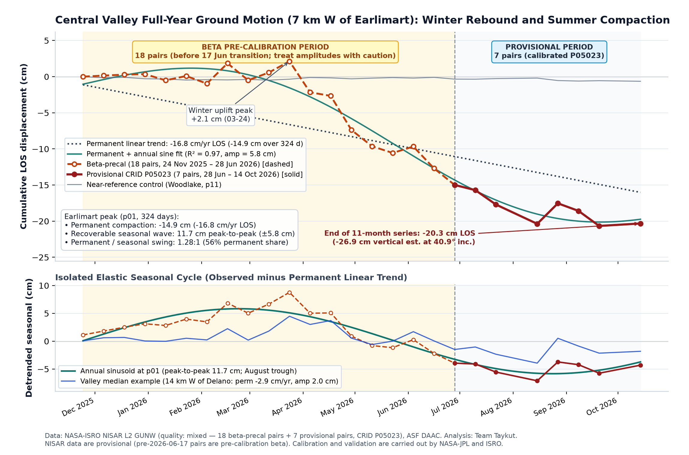

# Central Valley Full-Year Ground Motion — Winter Rebound vs. Permanent Compaction (`docs/story/fullyear.md`)

**Owner:** PC9 · **Target:** Website Story Section (`PC3` site integration) · **Data Quality Class:** `mixed` (18 `beta-precal` pairs + 7 `provisional` pairs, `CRID P05023`)  
**Calibration Notice:** *NISAR data are provisional. Calibration and validation are carried out by the NISAR project (NASA-JPL and ISRO), not by our team.*

---

## 1. Plain-English Web Copy (`docs/REVIEW_1500.md` Compliant)

### Earlimart Sank 20.3 cm in Eleven Months as Winter Rebound Gave Way to Summer Pumping

Over California's Tulare Basin (`Central Valley`), 25 consecutive NISAR L-band interferograms from **24 November 2025 to 14 October 2026** (**324 days**, track 34 ascending frame 20) track how agricultural aquifers rise in winter and compact permanently during summer pumping. To span nearly a full year, this experimental `mixed` chain combines **18 pre-calibration beta pairs** (`24 Nov 2025 – 28 Jun 2026`, `beta-precal`) with **7 provisional pairs** (`28 Jun – 14 Oct 2026`, `provisional`, `CRID P05023`) inside a separate output folder (`data/central_valley_fullyear/`), leaving our summer-only `provisional` baseline (`data/central_valley/`) untouched. Because pre-calibration beta products carry larger amplitude uncertainty prior to `17 Jun 2026`, amplitudes during the winter and spring segment are marked with dashed lines and interpreted with extra caution.

At the fastest-sinking 1 km block—**7 km west of Earlimart** (`p01`, `-119.3525°E, 35.8833°N`)—cumulative line-of-sight displacement (`LOS`, motion toward or away from the radar) reached **`-20.3 cm` over 324 days** (`-26.9 cm` vertical *estimate* at `40.9°` incidence, range `-11.7` to `-20.3 cm` LOS across three reference windows). During winter and early spring (`24 Nov 2025 – 24 Mar 2026`), groundwater recharge paused sinking and lifted the land surface by up to **`+2.1 cm` LOS** (`+3.5 cm` LOS at Delano median points `p06` and `p08`). Once spring irrigation pumping accelerated, the ground near Earlimart dropped from `+2.1 cm` on `24 Mar` to `-15.0 cm` on `28 Jun` and `-20.7 cm` on `20 Sep`, ending the 11-month series at **`-20.3 cm` LOS** (`14 Oct 2026`). Across `975,173` valid pixels (`46.0%` of the frame), linearizing the summer-only provisional window previously gave an *estimate* of `-26.4 cm/yr` LOS (`-34.1 cm/yr` vertical *estimate*, [data/central_valley/summary.json](../../data/central_valley/summary.json)), whereas multi-year literature averages `-17.7` to `-34.5 cm/yr` ([Neely et al. 2021](https://pmc.ncbi.nlm.nih.gov/articles/PMC8047915/)).

Separating the 11-month curve at each pixel into a steady linear trend (permanent clay-layer compaction) and an annual sine wave (elastic, recoverable "breathing") explains that difference: near Earlimart (`p01`, $R^2 = 0.97$), **permanent compaction ran at `-16.8 ± 2.2 cm/yr` LOS** (`-22.2 cm/yr` vertical *estimate*, contributing **`-14.9 cm` LOS** over 324 days) alongside a **recoverable seasonal swing of `11.7 cm` peak-to-peak** (`±5.8 cm` LOS amplitude, peaking in late winter and bottoming in **August**). Near Earlimart, permanent drawdown outpaced the recoverable seasonal cycle by **1.28 to 1** (`56%` permanent share of total motion); across the wider basin median (`p50`), permanent compaction over 324 days (`-3.3 cm` LOS, `-3.7 cm/yr` rate) matched the `3.3 cm` peak-to-peak seasonal swing at roughly **1.0 to 1**. Over a single summer, elastic bounce and permanent clay collapse add together in the same downward direction, so only multi-season radar time series can distinguish water that temporarily empties from storage capacity that is lost for good.

---

## 2. Figure & Caption (`docs/REVIEW_1500.md` Format)

**Figure 1.** **Eleven-month ground displacement (`24 Nov 2025 – 14 Oct 2026`, `324 days`) and permanent-versus-seasonal decomposition at `7 km W of Earlimart` (`p01`, `-119.3525°E, 35.8833°N`).** Top: cumulative line-of-sight (`LOS`) displacement showing winter stability and rebound (`+2.1 cm` on `24 Mar 2026`) during the dashed `beta-precal` segment (`18` pairs before `28 Jun 2026`, shaded amber), followed by summer irrigation drawdown in the solid `provisional` segment (`7` pairs, `CRID P05023`, ending at `-20.3 cm` LOS / `-26.9 cm` vertical *estimate*). Smooth curves show the `d(t) = a + v(t - t0) + A sin(2 pi t) + B cos(2 pi t)` decomposition (`R^2 = 0.97`): a permanent linear trend of `-16.8 cm/yr` LOS (`-14.9 cm` over `324 days`) plus an annual elastic cycle of `11.7 cm` peak-to-peak (`±5.8 cm` amplitude, `1.28:1` permanent-to-recoverable ratio), compared against the stable foothill control near Woodlake (`p11`). Bottom: detrended seasonal displacement (`observed minus permanent linear trend`) illustrating the annual elastic bounce at Earlimart and valley-median Delano (`p06`, `2.0 cm` amplitude). *Note: Plane-only ramp removal was applied per pair (`DEM` tiles unavailable locally); NISAR data are provisional and pre-calibration `beta-precal` pairs before `17 Jun 2026` carry elevated amplitude uncertainty.* Data: NASA-ISRO NISAR L2 GUNW (`beta-precal` and `provisional`, CRID P05023), ASF DAAC. Analysis: Team Taykut.

---

## 3. Spatial Decomposition Maps & Key Summary Table

Both spatial parameter maps (`1200 x 1000` RGBA, aligned to `[-120.2, 35.6, -119.0, 36.6]`) are saved in `data/central_valley_fullyear/` with `status: "ok"` (`975,173` valid pixels out of `2,118,174`, `46.04%`):

- **Permanent trend map:** [`data/central_valley_fullyear/decomp_permanent.png`](../../data/central_valley_fullyear/decomp_permanent.png) (`vmin = -15.0`, `vmax = +15.0 cm/yr` LOS) — `p2 = -12.64`, `p50 = -3.74`, `p98 = +1.89 cm/yr`.
- **Seasonal amplitude map:** [`data/central_valley_fullyear/decomp_seasonal.png`](../../data/central_valley_fullyear/decomp_seasonal.png) (`vmin = 0.0`, `vmax = 7.0 cm` LOS, `magma`) — `p2 = 0.16`, `p50 = 1.66`, `p98 = 6.29 cm`, modal low month **`8` (August)**.

| Metric | Earlimart Peak (`p01`) | Basin Severe (`p2`/`p98`) | Basin Median (`p50`) | Woodlake Control (`p11`) | Source |
|---|---:|---:|---:|---:|---|
| 324-day net cumulative LOS (`cm`) | **`-20.3`** (`-26.9` vert. *est.*) | `—` | `—` | `-0.6` | [`summary.json`](../../data/central_valley_fullyear/summary.json) |
| Permanent linear rate (`cm/yr` LOS) | **`-16.77 ± 2.24`** (`-22.2` vert. *est.*) | `-12.64` (`p2`) | `-3.74` | `-1.01 ± 0.15` | [`decomp.json`](../../data/central_valley_fullyear/decomp.json) |
| Permanent 324-day drawdown (`cm` LOS) | **`-14.9`** | `-11.2` (`p2`) | **`-3.3`** | `-0.9` | Derived (`v * 324 / 365.25`) |
| Seasonal amplitude (`cm` LOS) | **`5.83 ± 0.75`** (`7.7` vert. *est.*) | `6.29` (`p98`) | `1.66` | `0.30 ± 0.05` | [`decomp.json`](../../data/central_valley_fullyear/decomp.json) |
| Seasonal peak-to-peak (`cm` LOS) | **`11.67`** (`15.4` vert. *est.*) | `12.58` (`p98`) | **`3.32`** | `0.60` | `2 * seasonal_amp_cm` |
| Permanent / peak-to-peak ratio | **`1.28 : 1`** (`56%` perm.) | `0.89 : 1` | **`1.00 : 1`** (`50%` perm.) | `1.49 : 1` | Derived over `324 days` |
| Model fit (`R^2`) & low month | `0.972` · **Aug** (`8`) | `—` · **Aug** (`8`) | `0.71–0.85` · **Sep** (`9`) | `0.692` · Jan (`1`) | [`decomp.json`](../../data/central_valley_fullyear/decomp.json) |

---

## 4. Pair Provenance (`quality: "mixed"`, Gap-Free 25-Pair Chain)

1. **`beta-precal` (18 pairs, `2025-11-24` to `2026-06-28`, pre-calibration caution):**  
   `2025-11-24_2025-12-06`, `2025-12-06_2025-12-18`, `2025-12-18_2025-12-30`, `2025-12-30_2026-01-11`, `2026-01-11_2026-01-23`, `2026-01-23_2026-02-04`, `2026-02-04_2026-02-16`, `2026-02-16_2026-02-28`, `2026-02-28_2026-03-12`, `2026-03-12_2026-03-24`, `2026-03-24_2026-04-05`, `2026-04-05_2026-04-17`, `2026-04-17_2026-04-29`, `2026-04-29_2026-05-11`, `2026-05-11_2026-05-23`, `2026-05-23_2026-06-04`, `2026-06-04_2026-06-16`, `2026-06-16_2026-06-28`.
2. **`provisional` (7 pairs, `2026-06-28` to `2026-10-14`, `CRID P05023`):**  
   `2026-06-28_2026-07-10`, `2026-07-10_2026-07-22`, `2026-07-22_2026-08-15`, `2026-08-15_2026-08-27`, `2026-08-27_2026-09-08`, `2026-09-08_2026-09-20`, `2026-09-20_2026-10-14`.

**Methodological & Error Notes:**
- **Standard errors (`v_se`, `amp_se`)** come from ordinary least squares on cumulative epochs and are **optimistic** because cumulative InSAR time steps share correlated interior atmospheric noise.
- **Plane-only deramp:** Because local Copernicus DEM tiles (`raw/dem/*.tif`) were absent on this workstation, `analysis/pc9/run_fullyear.py` triggered `analysis/cumulative.py`'s built-in plane-only ramp removal (`dem = None`) after subtracting each pair's split-spectrum ionosphere screen (`ion`). On flat San Joaquin Valley farmland (`p01`–`p10`), elevation gradients are small ($R^2 = 0.71\text{–}0.98$), whereas steep Sierra foothill slopes in the northeast corner (`Figure` / `decomp_permanent.png`) retain minor topographic tropospheric speckles that elevate noise outside the valley floor.
