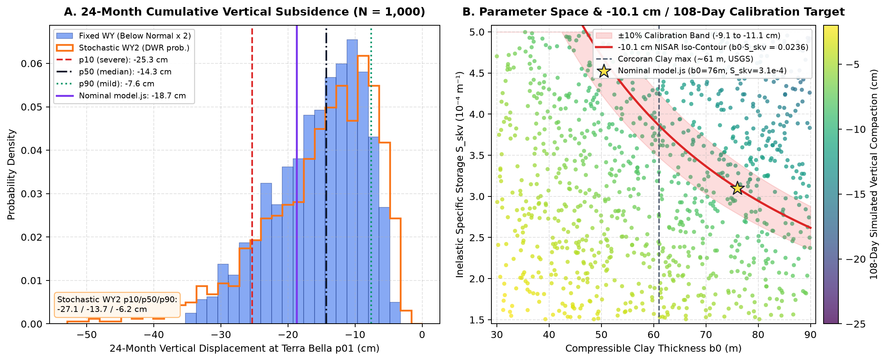

# Game Model Monte Carlo Sensitivity Analysis (`ValleyModel` / `game/model.js`)

> **Calibration Notice:** NISAR data are provisional. Calibration and validation are carried out by the NISAR project (NASA-JPL and ISRO), not by our team.

This analysis ports the exact hydrological water-balance and Terzaghi skeletal-compaction equations from `game/model.js` (read-only) to Python (`analysis/pc5/game_sensitivity.py`) and runs **`N = 1,000` Monte Carlo trials** (`seed = 20261114`) across documented physical parameter uncertainties at the Terra Bella (`p01`) calibration corridor.

## 1. Exact Calibration Check & Sampled Parameter Space

- **Uncalibrated (`k = 1.0`) 108-day output:** `d_model(k=1) =` **`-17.18 cm`** vertical (**`-13.33 cm`** LOS at `θ = 39.1°`).
- **Calibrated extraction multiplier:** `k = computeCalibratedDemandMultiplier(-10.1) =` **`0.6232`**, reproducing **`-10.10 cm`** vertical (**`-7.84 cm`** LOS) over the `2026-06-28 → 2026-10-14` (`108`-day) window (`0.00%` calibration residual).
- **24-month baseline (`Below Normal × 2`, `100%` pump, `60%` surface alloc):** **`-18.69 cm`** vertical (`-18.67 cm` irreversible inelastic, `-0.02 cm` net elastic; `-14.50 cm` LOS).

| Parameter (`game/model.js`) | Nominal `model.js` | Monte Carlo Prior | Physical Basis (`docs/story/game_model.md`) |
| :--- | :---: | :---: | :--- |
| Inelastic specific storage `S_skv` | `3.1 × 10⁻⁴ m⁻¹` | `Uniform(1.5 × 10⁻⁴, 5.0 × 10⁻⁴)` | Sneed (2001) USGS OFR 01-35 (`≥ 20 × S_ske` compaction regime) |
| Elastic specific storage `S_ske` | `1.0 × 10⁻⁵ m⁻¹` | `Uniform(0.5 × 10⁻⁵, 2.5 × 10⁻⁵)` | Sneed (2001) order-of-magnitude elastic skeleton compressibility |
| Compressible clay thickness `b0` | `76.0 m` | `Uniform(30.0, 90.0)` | USGS PP 497-E / Page 1986 Corcoran Clay (`≤ 61 m`) to CVHM aggregate fine interbeds (`76–82 m`) |
| Year-2 Water Year Type (stochastic ensemble) | `Below Normal` (Yr 1) | `W:0.30, AN:0.15, BN:0.17, D:0.18, C:0.20` | DWR San Joaquin Valley Index weights documented in `game/model.js` |

## 2. Monte Carlo Percentile Results (`N = 1,000` Trials)

| Simulation Metric (Vertical at Terra Bella `p01`) | `p10` (Severe) | `p50` (Median) | `p90` (Mild) | Mean ± Std | Nominal `model.js` |
| :--- | :---: | :---: | :---: | :---: | :---: |
| **108-Day Summer Window** (`Jun 28 → Oct 14`) | **-13.69 cm** | **-7.73 cm** | **-4.12 cm** | `-8.38 ± 3.64 cm` | `-10.10 cm` |
| **24-Month Cumulative (Fixed `Below Normal × 2`)** | **-25.32 cm** | **-14.30 cm** | **-7.62 cm** | `-15.50 ± 6.74 cm` | `-18.69 cm` |
| **24-Month Cumulative (Stochastic Year 2 Water Year)** | **-27.10 cm** | **-13.70 cm** | **-6.23 cm** | `-15.55 ± 8.77 cm` | `-18.69 cm` |

## 3. Where Does the `-10.1 cm / 108-Day` Target Sit in Parameter Space?

- **Percentile rank in parameter space:** Under the uniform `(S_skv, S_ske, b0)` prior (`108`-day `p10–p90` range `-13.69` to `-4.12 cm`, median `-7.73 cm`), **`30.0%`** of parameter draws produce subsidence equal to or deeper than the `-10.1 cm` NISAR vertical observation, and **`149/1,000` (`14.9%`)** fall within `±10%` (`-9.09` to `-11.11 cm`).
- **Equifinality hyperbola (`S_kv = b0 · S_skv`):** Because 108-day drawdown crosses the `0.3 m` preconsolidation buffer into virgin inelastic compaction, `Δb` depends almost purely on the dimensionless inelastic storativity product `S_kv = b0 · S_skv`. Reproducing `-10.1 cm` requires **`b0 · S_skv ≈ 0.02356`**: with `b0 = 76 m` (aggregate interbeds), `model.js` hits this contour at `S_skv = 3.10 × 10⁻⁴ m⁻¹`, whereas capping `b0` at USGS Corcoran Clay's `≤ 61 m` shifts the required calibrated compressibility slightly higher along the same curve to `S_skv ≥ 3.86 × 10⁻⁴ m⁻¹` (still well inside Sneed 2001's Tulare Basin range).
- **Parameter vs. climate variance:** Across two full water years, physical parameter spread spans `-25.3` to `-7.6 cm` (`17.7 cm` 80% inter-decile range), widening slightly to `-27.1` to `-6.2 cm` once DWR Water Year Year-2 stochasticity is added.
