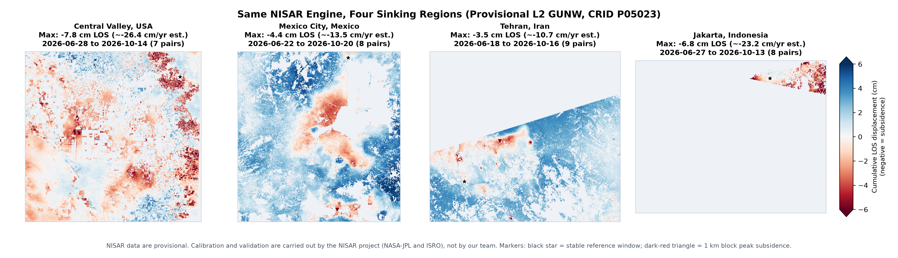

# Same Engine, Other Cities: Global NISAR Subsidence Showcase

> **Calibration Notice:** NISAR data are provisional. Calibration and validation are carried out by the NISAR project (NASA-JPL and ISRO), not by our team.

Our pipeline (`pipeline/subset.py` and `analysis/cumulative.py`) was built for California's Central Valley without site-specific tuning. To test whether the exact same code works anywhere NISAR flies, we ran it unchanged on three of the fastest-sinking cities on Earth using only **provisional** L2 GUNW products (`CRID P05023`, acquisition dates on or after `2026-06-17`).

---

## Summary Comparison (Provisional 108–120 Day Window)

| Region | Track / Frame | Period (`n` pairs) | Peak 1 km Block LOS (`cm`) | Reference Sensitivity (`cm`) | Vertical Estimate (`cm`) | Linearized Annual Rate Estimate (`cm/yr`) | Published Multi-Year Rate |
| :--- | :---: | :---: | :---: | :---: | :---: | :---: | :--- |
| **Central Valley, USA** | Path 34 A, Frame 20 | `2026-06-28` – `2026-10-14` (`7`, 108 d) | **-7.8** | `[-7.8, -4.7]` (3 refs) | **-10.1** ($\theta = 39.1^\circ$) | **-26.4** LOS | Peak `-17.7` to `-34.5` cm/yr ([Neely et al., 2021](https://pmc.ncbi.nlm.nih.gov/articles/PMC8047915/)); up to `-60` cm/yr in 2015–2016 drought ([NASA Earth Observatory](https://science.nasa.gov/earth/earth-observatory/san-joaquin-valley-is-still-sinking-89761/)) |
| **Mexico City, Mexico** | Path 113 D, Frame 79 | `2026-06-22` – `2026-10-20` (`8`, 120 d) | **-7.0** | `[-8.0, -4.6]` (3 refs) | **-9.7** ($\theta = 44.2^\circ$) | **-21.2** LOS | `~24–25` cm/yr (~`2 cm/month`) in high-impact lakebed zones ([NASA NISAR](https://www.nasa.gov/missions/nisar/us-indian-space-mission-maps-extreme-subsidence-in-mexico-city/)); −30 to −40 cm/yr historical InSAR ([Chaussard et al., 2014](https://doi.org/10.1016/j.rse.2013.10.004)) |
| **Tehran, Iran** | Path 56 A, Frame 19 | `2026-06-18` – `2026-10-16` (`9`, 120 d) | **-3.5** | `[-7.3, -3.5]` (2 refs) | **-4.7** ($\theta = 41.2^\circ$) | **-10.7** LOS | `> 10` cm/yr in severe aquifer compaction zones across Iran ([Haghighi & Motagh, 2024](https://pmc.ncbi.nlm.nih.gov/articles/PMC11086625/)) |
| **Jakarta, Indonesia** | Path 18 D, Frame 91 | `2026-06-27` – `2026-10-13` (`8`, 108 d) | **-6.8** | `1` ref only (`valid = 2.9%`) | **-9.3** ($\theta = 42.8^\circ$) | **-23.2** LOS | Typically `3–10` cm/yr, up to `20–28` cm/yr in northern coastal zones ([Abidin et al., 2015](https://piahs.copernicus.org/articles/372/115/2015/); [PMC10314896](https://pmc.ncbi.nlm.nih.gov/articles/PMC10314896/)) |

*Note: Linearized annual rates (`cumulative * 365.25 / days`) are **estimates** from a single summer–autumn window, not full-year measurements. Vertical estimates assume purely vertical motion (`LOS / cos(incidence)`).*

---

## City-by-City Notes

### 1. Mexico City (`data/global/mexico_city/`)
Mexico City sits on compressible ancient lakebed clays. Our 8-pair provisional chain (`120` days, `63.9%` valid pixels, mean reference coherence `0.82`) clearly resolves the eastern lakebed subsidence bowl. Following QA review (PC5), re-referencing to the stable SW volcanic margin (`-99.1840E, 19.3767N`) resolved an earlier in-basin reference bias (`-4.4` LOS with northern Texcoco reference) and yields a headline of `-7.0 cm` LOS (`-5.8 cm/100d`, `-9.7 cm` vertical est., `-21.2 cm/yr` linear LOS rate). Re-referencing across 3 reference windows yields `[-8.0, -4.6] cm` LOS, aligning with the `~24–25 cm/yr` rates reported by [NASA](https://www.nasa.gov/missions/nisar/us-indian-space-mission-maps-extreme-subsidence-in-mexico-city/) and `-30` to `-40 cm/yr` literature ([Chaussard et al., 2014](https://doi.org/10.1016/j.rse.2013.10.004)).

### 2. Tehran (`data/global/tehran/`)
Our 9-pair provisional chain (`120` days, `35.7%` valid pixels, mean reference coherence `0.93`) maps the well-known southwestern Tehran plain subsidence trough (`51.3018E, 35.6398N`). The primary reference (`51.1999E, 35.5448N`) yields `-3.5 cm` LOS (`-10.7 cm/yr` estimate), while re-referencing to the northern foothills (`51.4895E, 35.7019N`) gives `-7.3 cm` LOS (`~22.2 cm/yr` LOS estimate), consistent with multi-year Sentinel-1 InSAR findings in [Haghighi & Motagh (2024)](https://pmc.ncbi.nlm.nih.gov/articles/PMC11086625/).

### 3. Jakarta (`data/global/jakarta/`)
Jakarta is a coastal tropical megacity where dense vegetation and rapid urban change reduce L-band coherence and connected-component coverage in some late-summer pairs (`2026-09-07_2026-09-19` and `2026-09-19_2026-10-01` had `94–95%` NaN after masking), and the frame 91 swath covers only the northeastern corner of our bounding box (`2.9%` valid pixels across all 8 pairs). We report this honestly without relaxing any masks: the surviving coastal corridor (`107.0115E, -6.1406S`) shows `-6.8 cm` LOS over `108` days (`-23.2 cm/yr` estimate), within the `3–10 cm/yr` typical and `20–28 cm/yr` peak coastal range documented by [Abidin et al. (2015)](https://piahs.copernicus.org/articles/372/115/2015/).
