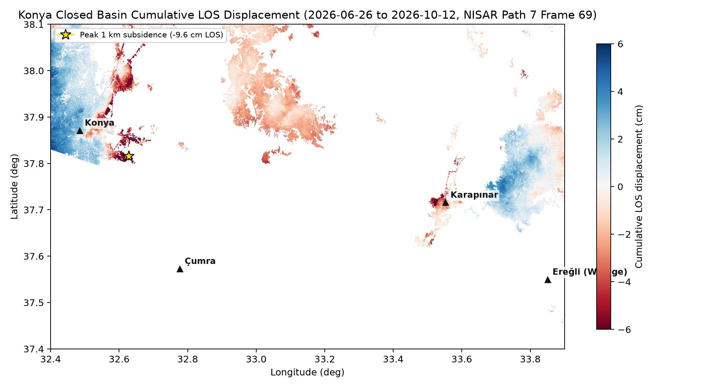

# Konya Closed Basin: Basin-Wide Subsidence Across Konya, Çumra, and Karapınar

To capture the full spatial footprint of Turkey's Konya Closed Basin (`32.4, 37.4, 33.9, 38.1`), we processed 8 consecutive provisional NISAR L2 GUNW pairs (Path 7 Descending, Frame 69, `CRID P05023`) from `2026-06-26` to `2026-10-12` (108 days). Path 7 Frame 69 covers 100% of the basin from Konya city and Çumra in the west to Karapınar's sinkhole belt in the east. Across the plain, the 1 km block-median peak cumulative subsidence reaches `-9.6 cm` LOS (three-reference sensitivity range `-14.0` to `-9.6 cm`; approximately `-12.1 cm` vertical at 37.6° incidence), centered at `32.628°E, 37.816°N` south of Konya city.

**Physical drivers:** Heavy summer groundwater extraction for irrigated agriculture in this semi-arid closed basin draws down aquifer heads, driving both poroelastic/inelastic compaction of unconsolidated basin sediments and subsurface stress changes over soluble carbonate formations.

**Actionable insight:** Regional water managers and municipalities should use this basin-wide deformation map to guide groundwater well permitting, enforce metered extraction limits, and focus in-situ piezometric and engineering inspections on high-subsidence agricultural zones and documented sinkhole corridors.

**Alignment with NASA NISAR Resources:** As outlined in the [NISAR Sinkholes and Cavern Collapse White Paper](https://assets.science.nasa.gov/content/dam/science/missions/nisar/nisar-jpl/pdf/NISAR_Applications_Sinkholes1.pdf) ([NISAR Societal Benefits](https://science.nasa.gov/mission/nisar/societal-benefits/)), dissolution in soluble bedrock can cause slow or sudden collapse where spaceborne radar helps map regional surface deformation and potential precursory settling—without claiming to predict individual sinkhole collapse events. This basin-scale groundwater story also parallels NASA's [Land Subsidence StoryMap](https://storymaps.arcgis.com/stories/109e602e748346f3be8dc89124619828) (Peacock, A., An, K., Pinto, N., & Lou, Y., 2024, Zenodo, https://doi.org/10.5281/zenodo.10818833) from California's Central Valley to Turkey's agricultural heartland.
