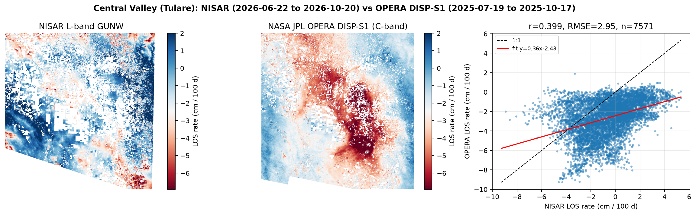
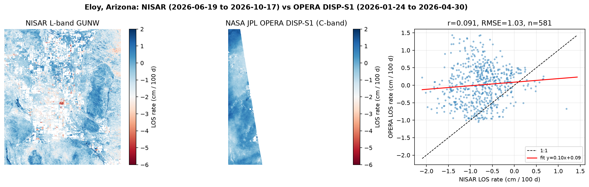
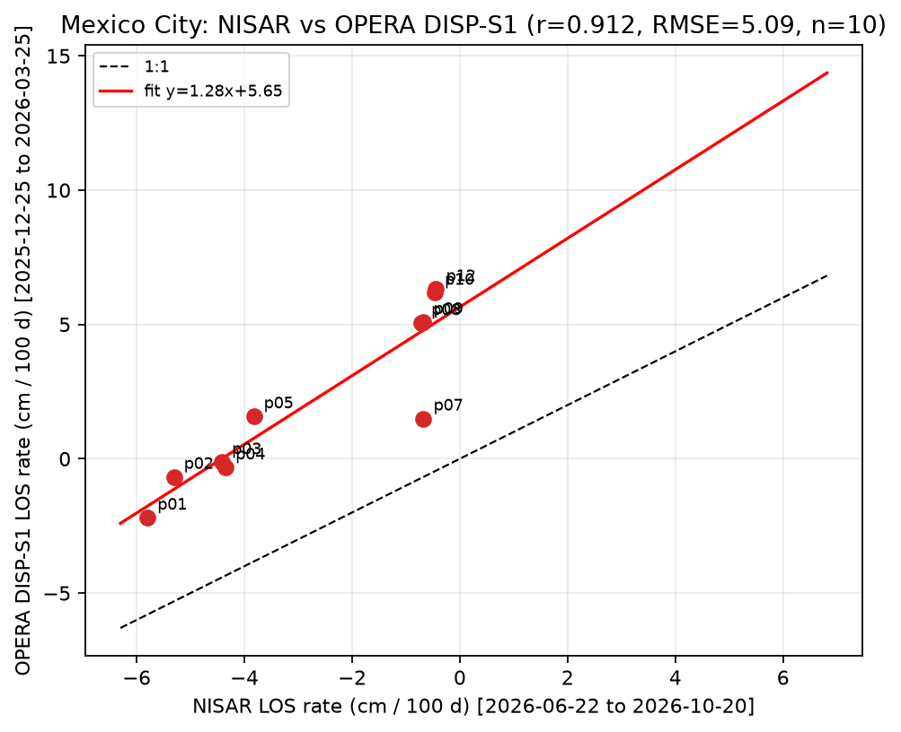

# NISAR vs NASA JPL OPERA DISP-S1 Cross-Check

Independent validation of NISAR L-band GUNW displacement against NASA JPL OPERA DISP-S1 (Sentinel-1 C-band) across three North American subsidence basins.

> **Note:** NISAR data are provisional. Calibration and validation are carried out by the NISAR project (NASA-JPL and ISRO), not by our team.

| Basin | NISAR Period | OPERA Period | Co-located `n` | Pearson `r` | RMSE (`cm/100d`) | Slope | Figure |
|---|---|---|---:|---:|---:|---:|---|
| `central_valley` | `2026-06-22 → 2026-10-20` | `2025-07-19 → 2025-10-17` | 7571 | **0.399** | 2.95 | 0.362 |  |
| `eloy` | `2026-06-19 → 2026-10-17` | `2026-01-24 → 2026-04-30` | 581 | **0.091** | 1.03 | 0.102 |  |
| `mexico_city` | `2026-06-22 → 2026-10-20` | `2025-12-25 → 2026-03-25` | 10 | **0.912** | 5.09 | 1.278 |  |

## Methodology & LOS Geometry Note

- **Central Valley (direct temporal overlap):** Two OPERA F38502 cumulative frames (`2025-10-17 → 2025-11-28` and `2025-10-17 → 2026-02-14`) were differenced to isolate `2025-11-28 → 2026-02-14` (78 days), matching NISAR Path 114 `2025-11-30 → 2026-02-10` (72 days) on the exact `EPSG:32611` UTM grid and shared reference window.
- **Eloy & Mexico City (cross-season rate comparison):** OPERA DISP-S1 archive currently extends through spring 2026 (`2026-04-30` / `2026-03-31`), whereas NISAR provisional starts `2026-06-17`. Both products are normalized to `cm / 100 days` over co-located 1 km blocks (Eloy) or 300 m point windows (Mexico City).
- **LOS geometry:** NISAR L-band (`~37–43°` incidence) and Sentinel-1 C-band (`~39°` IW incidence) view angles differ slightly; for purely vertical subsidence, `LOS = V * cos(theta)`, introducing up to ~5–10% geometric scaling difference plus seasonal pumping variations between winter/spring and summer.
- **Houston/Katy:** No NISAR provisional/beta coverage in `data/global/` at check time (`OPERA F38239` spans `2025-09-23 → 2026-02-14`).
