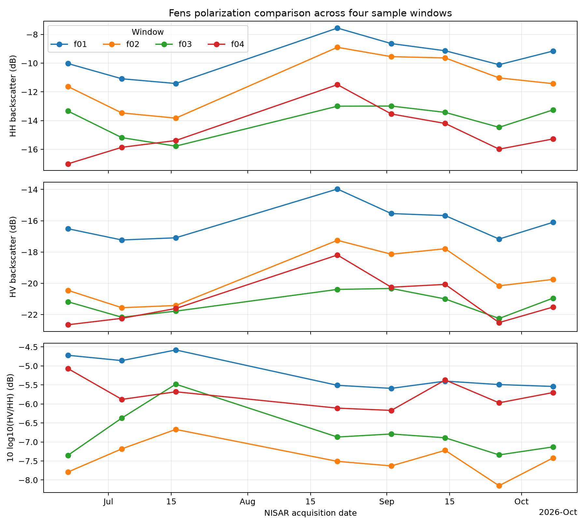

# Which polarization best shows crop-stage change?

The NASA NISAR Food Security paper describes repeated radar observations as a way to track crop structure, moisture, and growth stage, but it does not rank HH, HV, or their ratio. [NASA NISAR Food Security: Crop Area Monitoring](https://assets.science.nasa.gov/content/dam/science/missions/nisar/nisar-jpl/pdf/NISAR_Applications_Food_Security1.pdf)

HH is co-polarized and responds to surface and ground interactions; soil roughness and moisture-driven changes in the dielectric constant can alter its return even when crop structure does not change. [NASA Earthdata, Intro to SAR](https://www.earthdata.nasa.gov/learn/earth-observation-data-basics/sar) · [The SAR Handbook, Chapter 2](https://earthdata.nasa.gov/s3fs-public/2025-04/SARHB_CH2_Content.pdf)

HV is cross-polarized and responds to volume scattering within vegetation, so it is the most directly interpretable channel for canopy structure. [The SAR Handbook, Chapter 2](https://earthdata.nasa.gov/s3fs-public/2025-04/SARHB_CH2_Content.pdf)

Across four 480 m Fens sample windows and eight provisional dates, mean temporal range was 4.27 dB for HH, 3.49 dB for HV, and 1.36 dB for 10 log10(HV/HH); HH had the widest measured swing, while the ratio was most stable. These results make HV the strongest physical indicator of crop structure, but this sparse series cannot identify sowing or harvest dates without crop labels and denser observations.

## Broader NISAR context

NASA's NISAR StoryMap uses airborne radar observations from 2013–2017 to show Central Valley subsidence along the California Aqueduct; our 2026 NISAR work revisits that valley from space, checks motion against GPS, and ranks canal and road segments, while Fens crop monitoring is a separate application. [NISAR StoryMaps: Land Subsidence](https://storymaps.arcgis.com/stories/109e602e748346f3be8dc89124619828) · Attribution: Peacock, A., An, K., Pinto, N., & Lou, Y. (2024). *NISAR ArcGIS StoryMaps*. [Zenodo](https://doi.org/10.5281/zenodo.10818833).

