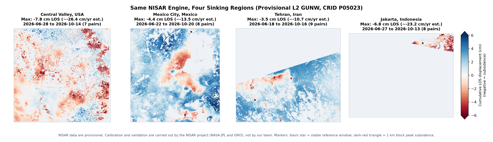

# Press Summary: Tracking Earth's Sinking Aquifers from Space with NASA–ISRO NISAR

> **Calibration Notice:** *NISAR data are provisional. Calibration and validation are carried out by the NISAR project (NASA-JPL and ISRO), not by our team.*

**Ankara / Lincoln — 14 November 2026.** Using open **provisional** L-band radar interferograms from the newly operational NASA–ISRO **NISAR** satellite (`CRID P05023`, `>= 17 June 2026`), high school student team **Team Taykut** (ASELSAN Vocational and Technical Anatolian High School, Ankara) has built an open-source, single-command processing and risk platform—**NISAR Pulse**—that maps groundwater-driven land subsidence, infrastructure tilt, and human exposure across agricultural basins and megacities worldwide.

Across `108–120` days of summer–autumn 2026 observations, the team applied the exact same un-tuned L-band workflow (`pipeline/nisarpulse/`) to California's **Central Valley** (`−7.8 cm` line-of-sight peak near Terra Bella; `0.317 km³/yr` permanent aquifer storage loss in a mixed full-year estimate), Türkiye's **Konya Closed Basin & Karapınar** (`−9.6 cm` basin peak; `−5.9 cm` near Karapınar where land within `1 km` of `29` verified sinkholes sank `6.4×` faster than the surrounding plateau), the **Sacramento–San Joaquin Delta** (`−1.3 cm`), and four major sinking cities (**Jakarta `−6.8 cm`**, **Mexico City `−4.4 cm`**, **Tehran `−3.5 cm`**, and **Beijing `−1.4 cm`**)—with the global atlas actively expanding toward `~20` basins. Over California, NISAR displacement tracks `10` continuous Nevada Geodetic Laboratory GPS stations at `r = 0.924` (`1.00 cm` median RMSE) while identifying `81 / 645` canal and road segments tilting above `20 mm/km`, led by the Tulare Irrigation District Canal (`57.01 mm/km`) and California Aqueduct (`49.12 mm/km`).

To turn multi-gigabyte satellite files into actionable local decisions, **NISAR Pulse** pairs an interactive 2D/3D web explorer (`web/`, `web3d/`) with **Valley Under Pressure**, a 24-month Terzaghi soil-compaction simulator matched to NISAR's Terra Bella measurements (`k = 0.6232`). Overlaying WorldPop population grids and USDA/ESA land cover shows **`141,555` residents** living on ground sinking faster than `2 cm` LOS across the Central Valley and Konya Basin (`79.2%` of California's `> 2 cm` footprint is active cropland), while reporting honest detection limits (`below_detection` over London clay, `2.9%` valid pixel coverage in vegetated Jakarta) so water boards, engineers, and communities see both what radar resolves and where uncertainty remains.

### Key Numbers at a Glance
- **`1.00 cm` median GPS RMSE (`r = 0.924`)** across `10` continuous Central Valley stations (`108` days, `7` provisional pairs).
- **`57.01 mm/km` peak canal tilt** (`81 / 645` segments `> 20 mm/km` in California; `6.4×` faster sinking within `1 km` of `29` Karapınar sinkholes, `p = 0.0001`).
- **`141,555` residents & `8` provisional basins** mapped so far (`−9.6 cm` Konya Basin, `−7.8 cm` Central Valley, `−6.8 cm` Jakarta, `−5.9 cm` Karapınar, `−4.4 cm` Mexico City).

### Project Links & Contact
- **Live Interactive Web Application:** https://keremsumer2010-tech.github.io/aseltech/
- **Open-Source Repository & Data:** https://github.com/keremsumer2010-tech/aseltech
- **Team:** Team Taykut — ASELSAN Vocational and Technical Anatolian High School, Ankara, Türkiye (NASA Space Apps Challenge 2026, Lincoln, UK)
