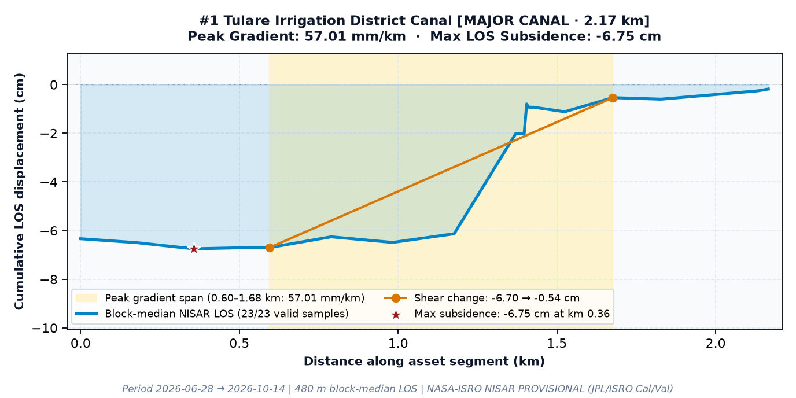
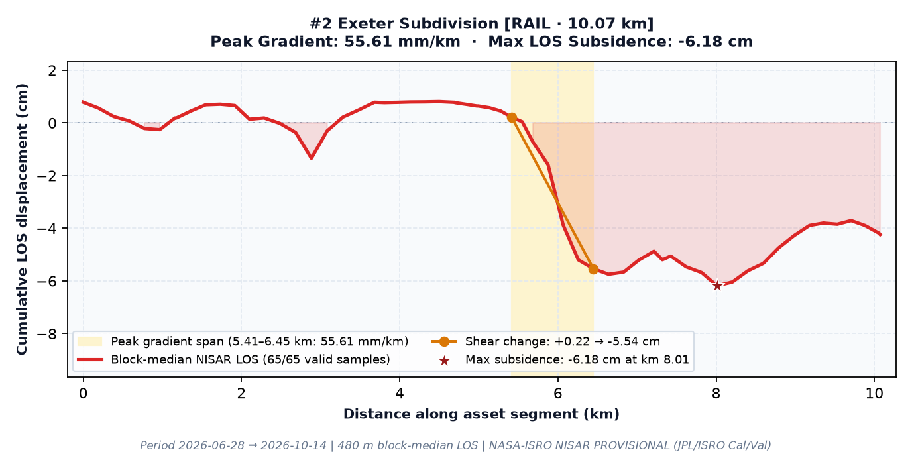
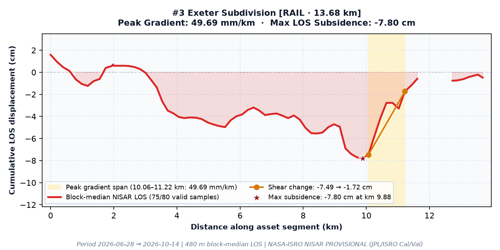
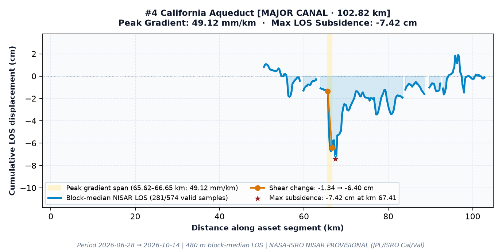
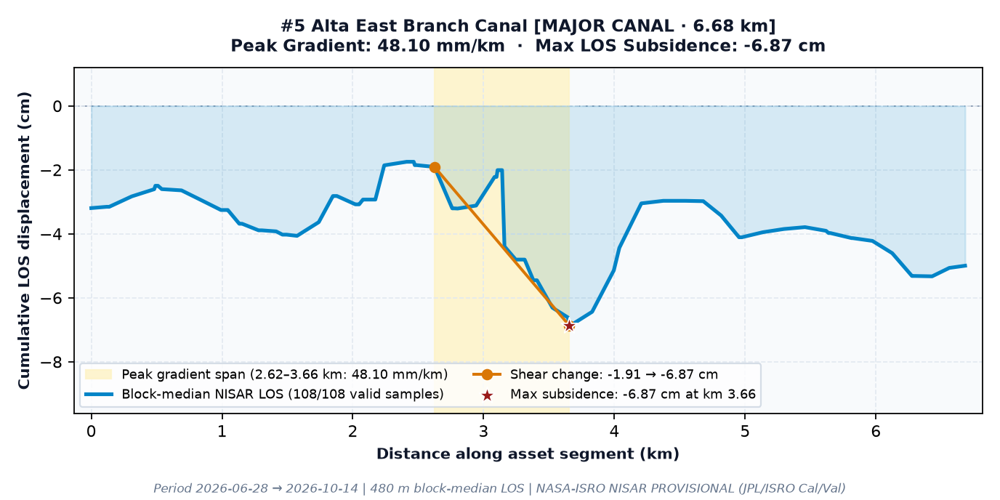
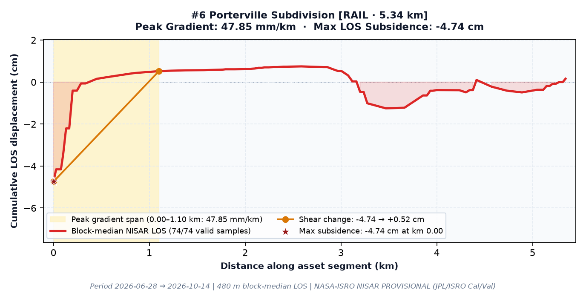
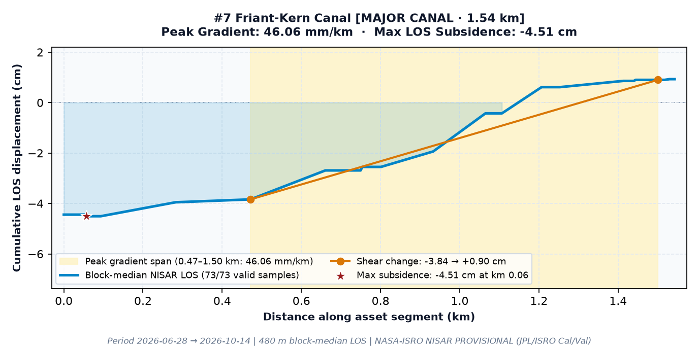
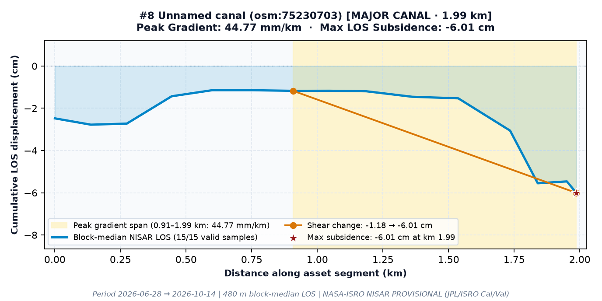
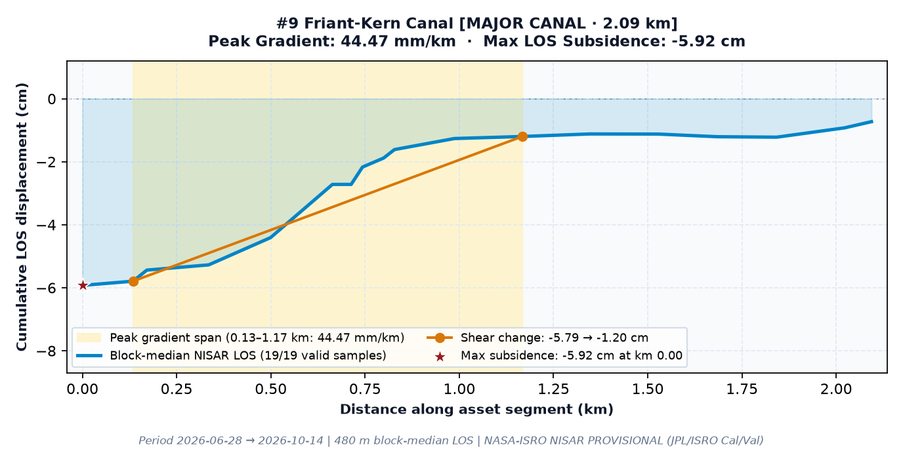
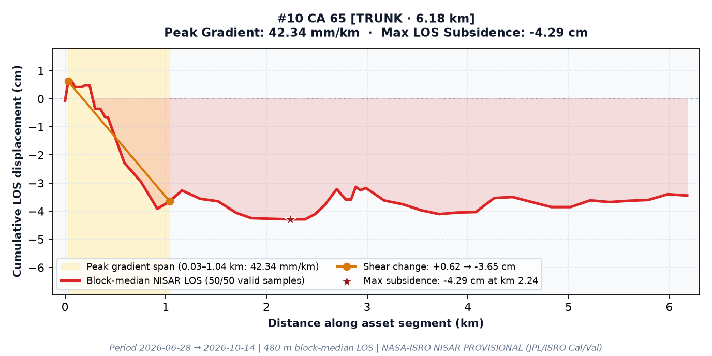

# Infrastructure Subsidence Risk Dossier — Central Valley Top 10 Segments

> **Provisional Notice:** NISAR data are provisional. Calibration and validation are carried out by the NISAR project (NASA-JPL and ISRO), not by our team.

**Observation Window:** `2026-06-28` → `2026-10-14` (Track 34 Ascending, Frame 20, 108 days)  
**Asset Screening:** `645` evaluated OpenStreetMap segments (`3238` total mapped) — **`81` high risk**, `131` medium risk, `433` low risk  
**High-Risk Thresholds:** Differential LOS gradient ≥ `10.0 mm/km` over ≥ `1000 m` OR max subsidence ≥ `10.0 cm` (`480 m` spatial block median along `200 m`-densified centerlines).

---

## 1. What This Means for Conveyance & Linear Infrastructure

Steep subsidence gradients of **44–57 mm/km** measured over just 108 days show localized, uneven ground flexure that warps gravity-fed canal inverts, cracks concrete linings, and reduces bridge clearance far more severely than uniform basin-wide sinking. As documented on the **Friant-Kern Canal** near Terra Bella (where the Middle Reach Capacity Correction Project / Friant Water Authority and KVPR 2017 report over **60% conveyance capacity loss**, from ~4,000 cfs design flow down to ~1,600 cfs in the worst reach, requiring over USD 300M remediation), differential compaction directly bottlenecks California's water delivery corridors as well as rail tracks and highways.

## 2. Spotlight: California Aqueduct & Major Irrigation Canals

Five of the Top 10 highest-gradient segments across the entire San Joaquin footprint are water-conveyance canals:

- **#1 Tulare Irrigation District Canal (`canal`, `2.17 km`, `57.01 mm/km`, max `-6.75 cm`):** Highest differential shear rate in the footprint, transitioning sharply across a 1.08 km span (`0.60 → 1.68 km`).
- **#4 California Aqueduct (`canal`, `102.82 km`, `49.12 mm/km`, max `-7.42 cm` LOS / `~-9.6 cm` vertical estimate):** State Water Project's flagship arterial aqueduct exhibits multiple deep bowls and a `49.12 mm/km` shear transition near `65.6–66.7 km` along the evaluated corridor. This directly extends NASA's airborne L-band UAVSAR monitoring highlighted in the official **NASA NISAR Land Subsidence StoryMap** ([Peacock et al. 2024](https://storymaps.arcgis.com/stories/109e602e748346f3be8dc89124619828); [Zenodo DOI: 10.5281/zenodo.10818833](https://doi.org/10.5281/zenodo.10818833)), where UAVSAR measured **over 40 inches (`>100 cm`, or `~20–25 cm/yr`)** of cumulative sinking along the California Aqueduct between 2013 and 2017 (Miller et al. 2020; Jones et al. 2020). Our 2026 spaceborne NISAR 108-day peak of `-7.42 cm` LOS (`~-25.1 cm/yr` annualized summer rate estimate) is of the same order of magnitude, showing that drought-era compaction along the aqueduct remains active in 2026.
- **#5 Alta East Branch Canal (`canal`, `6.68 km`, `48.10 mm/km`, max `-6.87 cm`):** East-side irrigation feeder experiencing steep differential settling toward the Tulare/Visalia sub-basin.
- **#7 & #9 Friant-Kern Canal (`canal`, `1.54 km` & `2.09 km`, `46.06` & `44.47 mm/km`, max `-4.51` & `-5.92 cm`):** Two distinct reaches of the federal canal register Top-10 gradients directly matching historically impacted conveyance segments near Terra Bella / Porterville.

*(Rail and highway lifelines round out the list: **Exeter Subdivision** `#2` at `55.61 mm/km` and `#3` reaching `-7.80 cm` valley-wide peak LOS, **Porterville Subdivision** `#6` at `47.85 mm/km`, and **CA 65** `#10` at `42.34 mm/km`.)*

### 2.1 Comparison: 2026 Spaceborne NISAR vs. 2013–2017 Airborne NASA UAVSAR along the California Aqueduct

| Metric | NASA Airborne UAVSAR (2013–2017) | 2026 Spaceborne NISAR (Track 34 Asc, Provisional) | Physical & Operational Comparison |
| :--- | :--- | :--- | :--- |
| **Sensor & Wavelength** | Airborne L-band SAR (`~24 cm`, UAVSAR) | Spaceborne L-band SAR (`24.2 cm`, NISAR L2 GUNW) | Same L-band wavelength; spaceborne 12-day repeat covers the full valley simultaneously |
| **Observation Period** | `2013–2017` (~4.5 years, multi-year drought) | `2026-06-28` → `2026-10-14` (`108 days`, 1 irrigation season) | Single summer season captures peak agricultural pumping drawdown |
| **California Aqueduct Peak Sinking** | `> 40 inches` (`> 101.6 cm` cumulative; `~20–25 cm/yr`) | `-7.42 cm` LOS (`~-9.6 cm` vertical *estimate* in 108 d; `~-25.1 cm/yr` LOS annualized *estimate*) | Same order of magnitude (`~20–25 cm/yr` during active summer pumping) |
| **Peak Differential Tilt** | Localized subsidence bowls warping concrete canal linings | `49.12 mm/km` over `1.03 km` (`km 65.62` to `km 66.65`: `-1.34` → `-6.40 cm` LOS) | Pinpoints the exact 1 km shear transition requiring liner and freeboard inspection |
| **Primary Reference** | [NASA NISAR StoryMap](https://storymaps.arcgis.com/stories/109e602e748346f3be8dc89124619828) ([Peacock et al. 2024](https://doi.org/10.5281/zenodo.10818833)); Miller et al. (2020); Jones et al. (2020) | `data/central_valley/assets.json` (`osm_id=24016778`, [risk_4.png](media/risk_4.png)) | Demonstrates how spaceborne NISAR operationalizes NASA's StoryMap decision-support vision in 2026 |

## 3. Top 10 High-Risk Segments Summary Table

| Rank | Segment Name | Type | Length (km) | Peak Gradient (mm/km) | Max Subsidence (cm) | OSM ID | Profile Chart |
| :---: | :--- | :--- | :---: | :---: | :---: | :---: | :---: |
| **1** | Tulare Irrigation District Canal **(Major Canal)** | `canal` | 2.17 | **57.01** | -6.75 | `79592963` | [risk_1.png](media/risk_1.png) |
| **2** | Exeter Subdivision | `rail` | 10.07 | **55.61** | -6.18 | `196474322` | [risk_2.png](media/risk_2.png) |
| **3** | Exeter Subdivision | `rail` | 13.68 | **49.69** | -7.80 | `196530229` | [risk_3.png](media/risk_3.png) |
| **4** | California Aqueduct **(Major Canal)** | `canal` | 102.82 | **49.12** | -7.42 | `24016778` | [risk_4.png](media/risk_4.png) |
| **5** | Alta East Branch Canal **(Major Canal)** | `canal` | 6.68 | **48.10** | -6.87 | `202390442` | [risk_5.png](media/risk_5.png) |
| **6** | Porterville Subdivision | `rail` | 5.34 | **47.85** | -4.74 | `196158173` | [risk_6.png](media/risk_6.png) |
| **7** | Friant-Kern Canal **(Major Canal)** | `canal` | 1.54 | **46.06** | -4.51 | `1226257286` | [risk_7.png](media/risk_7.png) |
| **8** | Unnamed canal (osm:75230703) **(Major Canal)** | `canal` | 1.99 | **44.77** | -6.01 | `75230703` | [risk_8.png](media/risk_8.png) |
| **9** | Friant-Kern Canal **(Major Canal)** | `canal` | 2.09 | **44.47** | -5.92 | `79593586` | [risk_9.png](media/risk_9.png) |
| **10** | CA 65 | `trunk` | 6.18 | **42.34** | -4.29 | `211929583` | [risk_10.png](media/risk_10.png) |

## 4. Individual Distance–Displacement Profile Charts

### #1 — Tulare Irrigation District Canal (`canal`)

- **Length:** `2.17 km` | **Peak Differential Gradient:** `57.01 mm/km` (between `km 0.60` at `-6.70 cm` and `km 1.68` at `-0.54 cm`) | **Max LOS Subsidence:** `-6.75 cm`

### #2 — Exeter Subdivision (`rail`)

- **Length:** `10.07 km` | **Peak Differential Gradient:** `55.61 mm/km` (between `km 5.41` at `+0.22 cm` and `km 6.45` at `-5.54 cm`) | **Max LOS Subsidence:** `-6.18 cm`

### #3 — Exeter Subdivision (`rail`)

- **Length:** `13.68 km` | **Peak Differential Gradient:** `49.69 mm/km` (between `km 10.06` at `-7.49 cm` and `km 11.22` at `-1.72 cm`) | **Max LOS Subsidence:** `-7.80 cm`

### #4 — California Aqueduct (`canal`)

- **Length:** `102.82 km` | **Peak Differential Gradient:** `49.12 mm/km` (between `km 65.62` at `-1.34 cm` and `km 66.65` at `-6.40 cm`) | **Max LOS Subsidence:** `-7.42 cm`

### #5 — Alta East Branch Canal (`canal`)

- **Length:** `6.68 km` | **Peak Differential Gradient:** `48.10 mm/km` (between `km 2.62` at `-1.91 cm` and `km 3.66` at `-6.87 cm`) | **Max LOS Subsidence:** `-6.87 cm`

### #6 — Porterville Subdivision (`rail`)

- **Length:** `5.34 km` | **Peak Differential Gradient:** `47.85 mm/km` (between `km 0.00` at `-4.74 cm` and `km 1.10` at `+0.52 cm`) | **Max LOS Subsidence:** `-4.74 cm`

### #7 — Friant-Kern Canal (`canal`)

- **Length:** `1.54 km` | **Peak Differential Gradient:** `46.06 mm/km` (between `km 0.47` at `-3.84 cm` and `km 1.50` at `+0.90 cm`) | **Max LOS Subsidence:** `-4.51 cm`

### #8 — Unnamed canal (osm:75230703) (`canal`)

- **Length:** `1.99 km` | **Peak Differential Gradient:** `44.77 mm/km` (between `km 0.91` at `-1.18 cm` and `km 1.99` at `-6.01 cm`) | **Max LOS Subsidence:** `-6.01 cm`

### #9 — Friant-Kern Canal (`canal`)

- **Length:** `2.09 km` | **Peak Differential Gradient:** `44.47 mm/km` (between `km 0.13` at `-5.79 cm` and `km 1.17` at `-1.20 cm`) | **Max LOS Subsidence:** `-5.92 cm`

### #10 — CA 65 (`trunk`)

- **Length:** `6.18 km` | **Peak Differential Gradient:** `42.34 mm/km` (between `km 0.03` at `+0.62 cm` and `km 1.04` at `-3.65 cm`) | **Max LOS Subsidence:** `-4.29 cm`

