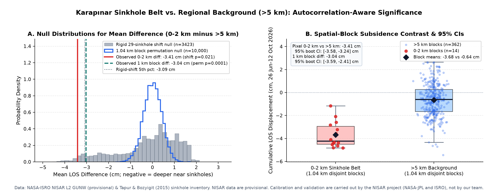

# Karapınar Obruk–Çökme İstatistiksel Anlamlılık Testi (Permutation, Blok-Bootstrap & Mekânsal Kaydırma)

**Doğrulanan dönem:** `2026-06-26 – 2026-10-12` (108 gün, 9 geçici L-bant NISAR epoku, `analysis/out/karapinar_cum.npz`)  
**Obruk envanteri:** `data/karapinar/sinkholes.geojson` (29 belgelenmiş obruk; kaynak: Tapur & Bozyiğit, 2015)  
**Üretici kod ve test:** [`analysis/pc5/sinkhole_stats.py`](../../analysis/pc5/sinkhole_stats.py) · [`analysis/pc5/test_sinkhole_stats.py`](../../analysis/pc5/test_sinkhole_stats.py)  
**Kalibrasyon uyarısı:** *NISAR data are provisional. Calibration and validation are carried out by the NISAR project (NASA-JPL and ISRO), not by our team.*

---

## 1. Halka Özeti (`40.194` geçerli `80 m` piksel)

| Uzaklık halkası (en yakın obruğa) | Geçerli piksel (`80 m`) | Ortalama kümülatif LOS (cm) | Medyan LOS (cm) | Std. sapma (cm) |
|---|---:|---:|---:|---:|
| `0–1 km` | 60 | -4.15 | -4.19 | 0.72 |
| `1–2 km` | 176 | -4.03 | -4.03 | 1.47 |
| **`0–2 km` (birleşik obruk kuşağı)** | **236** | **-4.06** | **-4.07** | **1.32** |
| `2–5 km` (geçiş halkası) | 985 | -1.96 | -1.82 | 1.93 |
| **`> 5 km` (bölgesel arka plan)** | **38,973** | **-0.65** | **-0.62** | **1.51** |

29 obruktan **16** tanesinin `2 km` yarıçapı içinde yüksek koherensli geçerli NISAR pikseli bulunmaktadır; tarımsal dekorelasyon nedeniyle kalan 13 obruğun hemen çevresi koherens eşiği (`gamma < 0.30`) altında maskelenmiştir.

---

## 2. Dört Katmanlı İstatistiksel Test Sonuçları (`0–2 km` vs. `> 5 km`)

| Test düzeyi | Örneklem (`yakın` / `arka plan`) | Ortalama fark (cm) | %95 Bootstrap GA (cm) | Permütasyon $p$-değeri | Parametrik / sıra testi |
|---|---:|---:|---:|---:|---|
| **Piksel düzeyi (`80 m`, naif bağımsızlık)** | 236 / 38,973 | **-3.41** | [-3.58, -3.24] | 0.0001 ($B = 10{,}000$) | Welch $t = -39.66$ ($p = 4.8 \times 10^{-107}$), Mann–Whitney $z = -24.16$ ($p = 5.5 \times 10^{-129}$) |
| **Ayrık `1.04 km` (`13×13` piksel) blokları** | 14 / 362 | **-3.04** (`-3.68` vs `-0.64`) | [-3.59, -2.41] | 0.0001 ($B = 10{,}000$) | Welch $t = -9.70$ ($df = 14.6$, $p = 9.7 \times 10^{-8}$), Mann–Whitney $z = -5.69$ ($p = 1.3 \times 10^{-8}$) |
| **Ayrık `2.08 km` (`26×26` piksel) makro-blokları** | 8 / 111 | **-2.93** (`-3.62` vs `-0.70`) | [-3.74, -1.99] | 0.0001 ($B = 10{,}000$) | Welch $t = -6.04$ ($df = 8.1$, $p = 3.0 \times 10^{-4}$), Mann–Whitney $z = -4.04$ ($p = 5.3 \times 10^{-5}$) |
| **Katı `29`-obruk kümesi mekânsal kaydırma (null)** | 3,423 geçerli kaydırma / 5,000 deneme | **-3.41** (null medyan: `+0.13`) | Null %2.5–%97.5: [-3.35, +1.65] | **0.0207** (tek/çift taraflı, 5. yüzdelik `-3.09 cm`) | 29 obruk kümesi bozulmadan saha içinde rastgele konumlara taşındı |

*Figure 1. Karapınar sinkhole belt (`0–2 km`) versus background (`>5 km`) cumulative LOS subsidence significance over 108 days (`2026-06-26` to `2026-10-12`), comparing `10,000`-iteration `1.04 km` block permutations, `10,000` bootstrap intervals, and `3,423` rigid constellation shifts across the valid interferogram footprint. Data: NASA-ISRO NISAR, ASF DAAC. Analysis: Team Taykut.*

---

## 3. Mekânsal Otokorelasyon Uyarısı

1. **Naif piksel testi (`p = 4.8 × 10⁻¹⁰⁷`) etkin örneklem büyüklüğünü abartır.** Komşu `80 m` InSAR pikselleri akifer deformasyon konisi, `1 km` çoklu-bakış penceresi ve troposferik/iyonosferik faz düzlemleri nedeniyle kilometre ölçeğinde pozitif otokorelasyon taşır. Bu yüzden 236 pikseli bağımsız gözlem saymak standart hatayı yapay biçimde daraltır.
2. **Ayrık `1.04 km` ve `2.08 km` blokları (`p = 0.0001`, Welch `p ≤ 0.0003`) kilometre ölçeğindeki komşuluk kümelenmesini giderir.** Her iki ayrımlaşmada da `< 5 km` sınırına dokunan tampon bloklar arka plandan hariç tutulmuştur; yine de `0–2 km` obruk kuşağı ortalama `2.9–3.0 cm` daha derin çökme göstermektedir.
3. **En muhafazakâr sınama olan katı küme kaydırma testi (`p = 0.0207`) bile `%95` güven düzeyinde anlamlıdır.** Bu test hem 29 obruğun kendi aralarındaki kümelenme geometrisini hem de interferogramın uzun dalga boylu arka plan yapısını korur; yalnızca 5 km üzerindeki bölgesel gradyan ve dekorelasyon maskesinin dışına çıkmayan yerleşimler incelenmiştir. Tek başına bu korelasyon obrukların çökmenin *nedeni* olduğunu değil, her iki olgunun aynı aşırı yeraltı suyu çekim ve karst çözünme zonu üzerinde yoğunlaştığını gösterir.

---

## 4. Halk Dilinde 3 Cümlelik Sonuç

1. Karapınar'da bilinen obrukların `2 km` yakınındaki alanlar, `2026-06-26 – 2026-10-12` arasındaki `108` günde ortalama **`4.1 cm`** çökerken `5 km`'den uzak arka plan alanlar yalnızca **`0.65 cm`** çöktü (`data/karapinar/assets.json`).
2. Ölçümler `1 km` ve `2 km`'lik bağımsız bloklara birleştirildiğinde ve obruk kümesinin tamamı uydu görüntüsü içinde `3,423` farklı konuma rastgele kaydırılarak sınandığında bile gözlenen **`3.4 cm`**'lik farkın tesadüfen ortaya çıkma olasılığı yaklaşık **`%2.1`** (`p = 0.021`, istatistiksel olarak anlamlı) çıktı (`docs/story/sinkhole_stats.md`).
3. Bu test obrukların yer altındaki su çekimiyle aynı çökme kuşağında kümelendiğini doğrulasa da uydu görüntüsü tek başına hangi parselde yeni obruk açılacağını önceden kesin olarak söyleyemez.
