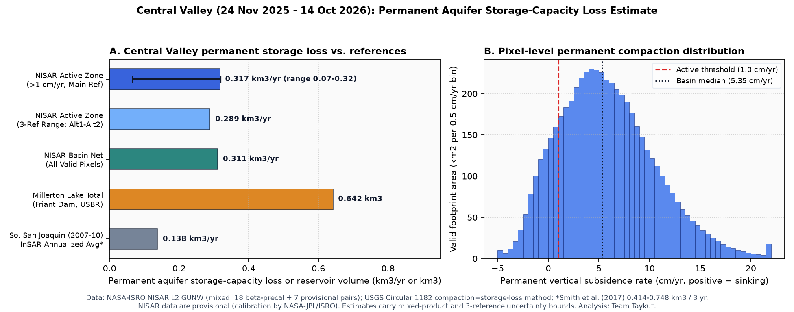

# Permanent Aquifer Storage-Capacity Loss (`docs/story/storage_loss.md` — Original Contribution O1)

**Owner:** PC8 (`M3hmeT1888`) · **Data:** `data/central_valley_fullyear/storage_loss.json`  
**Quality Class:** `mixed` (`18` pre-calibration beta pairs `24 Nov 2025 – 28 Jun 2026` + `7` provisional pairs `28 Jun – 14 Oct 2026`)  
**Calibration Notice:** *NISAR data are provisional. Calibration and validation are carried out by the NISAR project (NASA-JPL and ISRO), not by our team.*

---

## 1. Plain-English Summary (5 Sentences, `docs/REVIEW_1500.md` Compliant)

When groundwater pumping permanently crushes deep silt and clay beds, the pore volume lost underground cannot be refilled even in wet winters. Using the U.S. Geological Survey Circular 1182 principle that permanent aquitard compaction equals permanent storage-capacity loss, we integrate our 11-month NISAR permanent vertical subsidence rate across the Central Valley (`24 Nov 2025 – 14 Oct 2026`, `mixed` beta + provisional series). Across the **`4,508.3 km²`** of valid coherent pixels subsiding permanently faster than `1.0 cm/yr` (`7.04 cm/yr` mean vertical rate), the estimated permanent storage loss is **`0.317 km³/yr`** (`317.4 million m³/yr`, with a conservative 3-reference and 1-km block error range of **`0.066 to 0.320 km³/yr`**). That annual underground capacity loss equals roughly **half (`0.49×`) of Millerton Lake's total reservoir storage (`0.642 km³` behind Friant Dam)**, or about **`126,966` Olympic swimming pools (`2,500 m³` each)** every year. This single-year estimate sits in the same order of magnitude as published 2007–2010 InSAR permanent loss estimates in the southern San Joaquin Valley (`0.138–0.249 km³/yr` annualized), turning satellite radar maps into a direct water-management volume under California's Sustainable Groundwater Management Act (`SGMA`).

---

## 2. Technical Method, Uncertainty & Literature Comparison

- **Physical Formulation (`USGS Circular 1182`, [Galloway et al., 1999](https://pubs.usgs.gov/circ/circ1182/); Poland, 1984):** From our pixel-wise harmonic-linear decomposition (`data/central_valley_fullyear/decomp.json`, `d(t) = a + v(t - t0) + A sin(2πt) + B cos(2πt)`), the linear rate `v_cm_per_yr` isolates permanent (inelastic) compaction from seasonal elastic rebound (`A, B`). Projecting valid `reason == 0` pixels inside the Central Valley bounding box (`[-120.2, 35.6, -119.0, 36.6]`, `5,384.9 km²` total coherent footprint, `46.0%` coverage) from LOS to vertical via pixel-wise incidence angles (`cos θ`, median `41.5°`) and integrating `V_loss = Σ (-v_vert) × A_px` (`80 m × 80 m = 6,400 m²/pixel`) yields **`0.3174 km³/yr`** (`317.41 million m³/yr`) on the `4,508.29 km²` active zone (`v_vert < -1.0 cm/yr`) and **`0.3110 km³/yr`** (`311.00 million m³/yr`) net across all valid pixels.
- **Uncertainty & Reference Sensitivity:** Independent-pixel formal standard error (`±0.00012 km³/yr`) understates uncertainty because cumulative InSAR epochs are temporally and spatially correlated. Grouping errors over `1 km × 1 km` (`13 × 13` pixel) blocks raises 1σ statistical uncertainty to `±0.00123 km³/yr`, while re-referencing the entire velocity field across the three independent stable windows in `data/central_valley_fullyear/summary.json` (`Main ref` `36.46°N, 119.15°W`: `0.289–0.317 km³/yr`; `Alt ref 1` `35.78°N, 120.06°W`: `0.069 km³/yr`; `Alt ref 2` `35.63°N, 119.59°W`: `0.077 km³/yr`) dominates the total **`0.0664–0.3198 km³/yr`** uncertainty envelope. Because decorrelated irrigated fields (`54.0%` of the bounding box) are not extrapolated, the true basin-wide permanent loss could be larger.
- **Published Benchmarks:**
  - **Smith et al. (2017, *Water Resources Research*):** Southern San Joaquin Valley InSAR compaction (2007–2010) yielded `0.414–0.748 km³` over 3 years (`~0.138–0.249 km³/yr` annualized), directly matching the order of magnitude of our `0.317 km³/yr` (`0.066–0.320 km³/yr`) estimate over the wider Tulare–Kern footprint.
  - **[Ojha et al. (2018, *Scientific Reports*)](https://pmc.ncbi.nlm.nih.gov/articles/PMC6136988/):** During the 2012–2015 California drought (`~24–29 km³` total groundwater depletion), inelastic compaction permanently destroyed `0.4%–3.25%` of regional aquifer storage capacity.
  - **Karapınar Full-Year Status:** `data/karapinar_fullyear/decomp.json` is not yet generated; `storage_loss.py` will compute `data/karapinar_fullyear/storage_loss.json` as soon as PC9 publishes the Karapınar full-year decomposition.

---

## 3. Figure (`docs/story/media/pc8_storage_loss.png`)

**Figure (O1).** **Central Valley permanent aquifer storage-capacity loss estimate (`24 Nov 2025 – 14 Oct 2026`, `mixed` beta + provisional NISAR series).** **A.** Active subsiding zone (`> 1 cm/yr` permanent vertical rate, `4,508.3 km²`) yields **`0.317 km³/yr`** (`317.4 million m³/yr`; black error bar shows the **`0.066–0.320 km³/yr`** 3-reference + 1-km block SE uncertainty range), compared against net basin-wide valid integration (`0.311 km³/yr`), USBR Millerton Lake total capacity (`0.642 km³`), and Smith et al. (2017) 2007–2010 southern San Joaquin annualized InSAR loss (`0.138 km³/yr` lower bound). **B.** Area-weighted distribution of pixel-level permanent vertical subsidence rates across the `5,384.9 km²` coherent footprint (median `5.35 cm/yr` vertical). *NISAR data are provisional. Calibration and validation are carried out by the NISAR project (NASA-JPL and ISRO), not by our team.*
