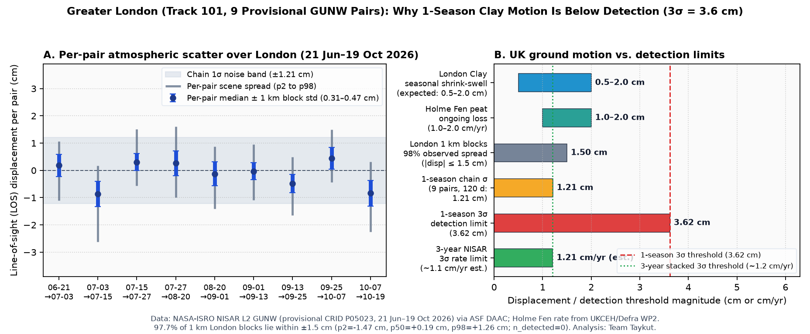

# UK Findings — Greater London Clay Detection Limit & Holme Fen Comparison (`docs/story/uk_findings.md`)

**Owner:** PC8 (`M3hmeT1888`) · **Target:** Ready-to-paste plain-English web section for PC9 (`web/index.html` / `web/science.html`) · **Data Quality Class:** `provisional` (`CRID P05023`, 21 Jun–19 Oct 2026)  
**Calibration Notice:** *NISAR data are provisional. Calibration and validation are carried out by the NISAR project (NASA-JPL and ISRO), not by our team.*

---

## 1. Plain-English Web Copy (5 Sentences — `docs/REVIEW_1500.md` Compliant)

### London Clay Shrink-Swell Is Below the One-Season Detection Threshold of 3.6 cm

Over Greater London, nine consecutive provisional NISAR radar pairs from 21 June to 19 October 2026 (120 days, track 101 ascending, frame 28) show no ground motion above the single-season measurement noise floor. Across the study area, per-pair 1 km block scatter ranges from 0.31 to 0.47 cm in line of sight (LOS, motion toward or away from the satellite), which accumulates over nine pairs to a chain uncertainty of 1.21 cm (1-sigma) and a 3-sigma detection threshold of 3.6 cm (`data/uk_clay/detection.json`). After removing long-wavelength atmospheric delay, 98 percent of 1 km blocks across London lie within plus or minus 1.5 cm (`p2 = -1.47 cm`, `p50 = +0.19 cm`, `p98 = +1.26 cm`), and zero blocks away from the scene edge exceed the 3.6 cm detection limit. Because seasonal shrink-swell movement in the London Clay formation typically spans only a few millimetres to 1–2 cm over a single summer, weather-related tropospheric delay of 1–3 cm per pair masks the clay signal in a four-month window. A similar scale challenge applies to Cambridgeshire's Holme Fen, where drained peat has sunk nearly 4 metres since 1851 (leaving the land 2.75 metres below sea level) and continues subsiding at 1–2 cm per year ([The Great Fen](https://www.greatfen.org.uk/about-great-fen/heritage/holme-fen-posts); [UKCEH / Defra WP2](https://lowlandpeat.ceh.ac.uk/sites/default/files/2022-07/Policy-brief-note-WP2.pdf)). While a single 120-day season resolves fast aquifer drawdown in California (-7.8 cm LOS) and Karapınar (-5.9 cm LOS), stacking a multi-year NISAR archive will reduce the annual rate uncertainty below 1 cm per year (estimate) and make both UK clay cycles and fenland peat loss directly measurable.

---

## 2. Figure & Caption (`docs/REVIEW_1500.md` Format)



**Figure 4.** (A) Per-pair line-of-sight (LOS) atmospheric scatter (`p2` to `p98` range and 1 km block standard deviation of 0.31–0.47 cm) across nine consecutive provisional NISAR interferograms over Greater London (21 Jun–19 Oct 2026), plotted against the 1-sigma chain noise band (`±1.21 cm`). (B) Comparison of expected seasonal London Clay shrink-swell motion (0.5–2.0 cm) and ongoing Holme Fen peat loss (1.0–2.0 cm/yr) against the 98% observed London block spread (`≤ 1.50 cm`), the one-season 3-sigma detection threshold (`3.62 cm`), and the projected three-year NISAR 3-sigma rate threshold (`~1.2 cm/yr`, estimate). Data: NASA-ISRO NISAR (provisional L2 GUNW, track 101 frame 28) via ASF DAAC; UKCEH / Defra WP2; The Great Fen. Analysis: Team Aseltech.

---

## 3. Ready-to-Paste HTML Block for PC9 (`web/`)

```html
<section class="uk-detection-finding">
  <h3>London Clay shrink-swell is below the one-season detection threshold of 3.6 cm</h3>
  <p>
    Over Greater London, nine consecutive provisional NISAR radar pairs from 21 June to 19 October 2026 (120 days, track 101 ascending, frame 28) show no ground motion above the single-season measurement noise floor. Across the study area, per-pair 1 km block scatter ranges from 0.31 to 0.47 cm in line of sight (LOS, motion toward or away from the satellite), which accumulates over nine pairs to a chain uncertainty of 1.21 cm (1&sigma;) and a 3&sigma; detection threshold of 3.6 cm. After removing long-wavelength atmospheric delay, 98% of 1 km blocks across London lie within &plusmn;1.5 cm (p2 = &minus;1.47 cm, median = +0.19 cm, p98 = +1.26 cm), and zero blocks away from the scene edge exceed the 3.6 cm detection limit. Because seasonal shrink-swell movement in the London Clay formation typically spans only a few millimetres to 1&ndash;2 cm over a single summer, weather-related tropospheric delay of 1&ndash;3 cm per pair masks the clay signal in a four-month window. A similar scale challenge applies to Cambridgeshire&rsquo;s Holme Fen, where drained peat has sunk nearly 4 metres since 1851 (2.75 metres below sea level) and continues subsiding at 1&ndash;2 cm/yr (<a href="https://www.greatfen.org.uk/about-great-fen/heritage/holme-fen-posts" target="_blank" rel="noopener">The Great Fen</a>; <a href="https://lowlandpeat.ceh.ac.uk/sites/default/files/2022-07/Policy-brief-note-WP2.pdf" target="_blank" rel="noopener">UKCEH / Defra WP2</a>). While a single 120-day season resolves fast aquifer drawdown in California (&minus;7.8 cm LOS) and Karap&#305;nar (&minus;5.9 cm LOS), stacking a multi-year NISAR archive will reduce the annual rate uncertainty below 1 cm/yr (estimate) and make both UK clay cycles and fenland peat loss directly measurable.
  </p>
  <figure>
    
    <figcaption>
      Figure 4. (A) Per-pair line-of-sight atmospheric scatter (0.31&ndash;0.47 cm 1 km block std) across nine provisional NISAR pairs over Greater London (21 Jun&ndash;19 Oct 2026). (B) Expected London Clay shrink-swell (0.5&ndash;2.0 cm) and Holme Fen peat subsidence (1&ndash;2 cm/yr) compared with the one-season 3&sigma; detection limit (3.62 cm) and a multi-year stacked threshold (~1.2 cm/yr, estimate). Data: NASA-ISRO NISAR, ASF DAAC; UKCEH / Defra WP2; The Great Fen. Analysis: Team Aseltech.
    </figcaption>
  </figure>
</section>
```

---

## 4. Source Data Traceability

| Metric | Value | Source File |
|---|---|---|
| Observation period & pairs | `2026-06-21` to `2026-10-19` (120 days, 9 pairs) | [`analysis/out/uk_clay_pair_stats.json`](../../analysis/out/uk_clay_pair_stats.json) |
| Per-pair 1 km block std | `0.31 to 0.47 cm` (`[0.40, 0.46, 0.31, 0.45, 0.44, 0.31, 0.34, 0.40, 0.47]`) | [`data/uk_clay/detection.json`](../../data/uk_clay/detection.json) |
| Chain 1σ noise (`chain_sigma_cm`) | `1.21 cm` LOS | [`data/uk_clay/detection.json`](../../data/uk_clay/detection.json) |
| Single-season 3σ threshold (`detection_threshold_cm`) | `3.62 cm` (`3.6 cm`) LOS | [`data/uk_clay/detection.json`](../../data/uk_clay/detection.json) |
| 1 km blocks within `±1.5 cm` | `97.7%` (`98%`, `n_detected_blocks = 0`) | [`data/uk_clay/detection.json`](../../data/uk_clay/detection.json) |
| Quadratic-deramped block `p2 / p50 / p98` | `-1.47 / +0.19 / +1.26 cm` | [`data/uk_clay/detection.json`](../../data/uk_clay/detection.json) |
| Holme Fen historical & modern subsidence | `~4 m` since 1851 (`-2.75 m` ASL); `1–2 cm/yr` ongoing | [`docs/story/holme_fen.md`](holme_fen.md) |
