# NISAR vs. GNSS Validation Report — Central Valley, California

> **Provisional Notice:** NISAR data are provisional. Calibration and validation are carried out by the NISAR project (NASA-JPL and ISRO), not by our team.

**Period:** `2026-06-28` → `2026-10-14` (8 epochs, 108 days)  
**Stations evaluated:** `10` NGL continuous GPS stations inside the valid NISAR Track 34 Ascending footprint  
**Component compared:** NISAR vertical estimate (`LOS / cos(incidence)`) vs. 7-day-window median NGL vertical GPS, both zeroed on `2026-06-28`.

---

## 1. Final-Epoch Cross-Station Scatter

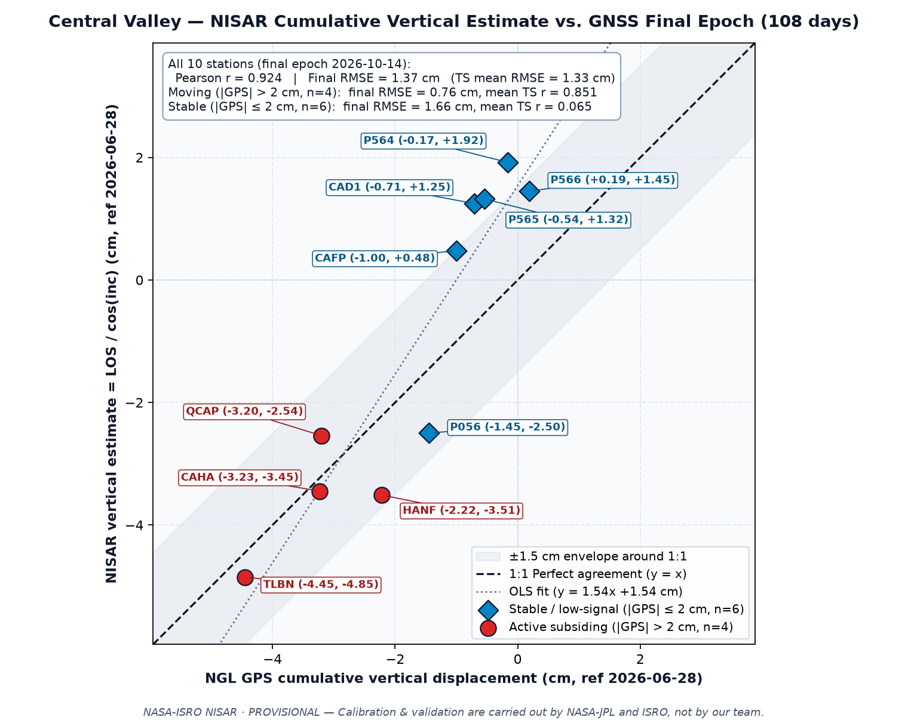

- **All 10 stations (final epoch `2026-10-14`):** cross-station Pearson **`r = 0.924`**, final-epoch **`RMSE = 1.37 cm`** (mean time-series RMSE = `1.33 cm`).
- **Active moving stations (`|GPS| > 2.0 cm`, `n = 4` — `TLBN, CAHA, QCAP, HANF`):** final-epoch **`RMSE = 0.76 cm`**, mean time-series RMSE = `0.88 cm`, mean temporal **`r = 0.851`**.
- **Stable / valley-margin stations (`|GPS| <= 2.0 cm`, `n = 6` — `P056, CAFP, CAD1, P565, P566, P564`):** final-epoch **`RMSE = 1.66 cm`**, mean time-series RMSE = `1.63 cm`, mean temporal **`r = 0.065`**.

## 2. Scientific Interpretation (Moving vs. Stable Stations)

Active subsiding stations inside the San Joaquin groundwater bowl (TLBN, CAHA, QCAP, HANF) accumulate -2.22 cm to -4.45 cm of vertical compaction over 108 days, placing their deformation signal cleanly above unmodeled L-band propagation noise and yielding high temporal correlations (r = 0.793 to 0.896) with sub-centimeter to ~1.2 cm time-series RMSE. In contrast, stable and valley-margin stations (|GPS| ≤ 2.0 cm) experience small real ground motion (-1.45 cm to +0.19 cm) that falls below the residual tropospheric water-vapor noise floor (~1–3 cm per pair, because external weather-model troposphere and solid-earth-tide screens were not subtracted in these provisional products). When the true physical displacement amplitude is smaller than the atmospheric noise variance, temporal Pearson correlation degrades toward zero or turns negative (r = -0.410 to +0.661) even though absolute errors stay bounded around 0.6–2.0 cm. Additionally, planar plus elevation-linear deramping anchored to the northeastern reference window (119.1456°W, 36.4532°N) leaves a +1.2 to +1.9 cm apparent positive offset across far-field margin stations (P564, P566, P565, CAD1). Overall, the strong 10-station cross-sectional fit (r = 0.924, final RMSE = 1.37 cm) confirms that NISAR reliably captures active subsidence magnitude while temporal tracking is physically diagnostic above ~2 cm of cumulative vertical motion.

## 3. Per-Station Metrics Summary

| Station | Regime | Lat / Lon | Incidence (°) | GPS Final (cm) | NISAR Est. Final (cm) | Time-Series RMSE (cm) | Time-Series r | Plot |
| :--- | :--- | :---: | :---: | :---: | :---: | :---: | :---: | :---: |
| **TLBN** | Moving (`|GPS| > 2 cm`) | 35.935°N, 119.407°W | 41.09 | -4.45 | -4.85 | 1.17 | +0.793 | [gnss_TLBN.png](media/gnss_TLBN.png) |
| **CAHA** | Moving (`|GPS| > 2 cm`) | 36.323°N, 119.623°W | 41.38 | -3.23 | -3.45 | 0.75 | +0.896 | [gnss_CAHA.png](media/gnss_CAHA.png) |
| **QCAP** | Moving (`|GPS| > 2 cm`) | 36.314°N, 119.632°W | 41.44 | -3.20 | -2.54 | 0.77 | +0.820 | [gnss_QCAP.png](media/gnss_QCAP.png) |
| **HANF** | Moving (`|GPS| > 2 cm`) | 36.215°N, 119.659°W | 41.75 | -2.22 | -3.51 | 0.83 | +0.895 | [gnss_HANF.png](media/gnss_HANF.png) |
| **P056** | Stable (`|GPS| <= 2 cm`) | 36.027°N, 119.063°W | 39.28 | -1.45 | -2.50 | 0.79 | +0.661 | [gnss_P056.png](media/gnss_P056.png) |
| **CAFP** | Stable (`|GPS| <= 2 cm`) | 36.424°N, 120.102°W | 43.34 | -1.00 | +0.48 | 2.79 | +0.069 | [gnss_CAFP.png](media/gnss_CAFP.png) |
| **CAD1** | Stable (`|GPS| <= 2 cm`) | 35.759°N, 119.244°W | 40.62 | -0.71 | +1.25 | 1.99 | -0.410 | [gnss_CAD1.png](media/gnss_CAD1.png) |
| **P565** | Stable (`|GPS| <= 2 cm`) | 35.744°N, 119.237°W | 40.62 | -0.54 | +1.32 | 2.00 | -0.252 | [gnss_P565.png](media/gnss_P565.png) |
| **P566** | Stable (`|GPS| <= 2 cm`) | 36.325°N, 119.229°W | 39.56 | +0.19 | +1.45 | 0.64 | +0.421 | [gnss_P566.png](media/gnss_P566.png) |
| **P564** | Stable (`|GPS| <= 2 cm`) | 35.623°N, 119.349°W | 41.38 | -0.17 | +1.92 | 1.57 | -0.101 | [gnss_P564.png](media/gnss_P564.png) |

## 4. Individual Station Time-Series Plots

### TLBN

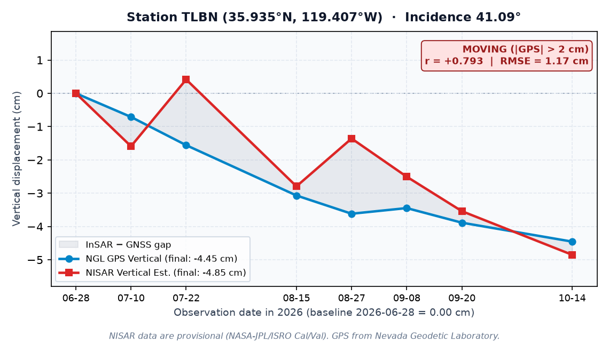

### CAHA

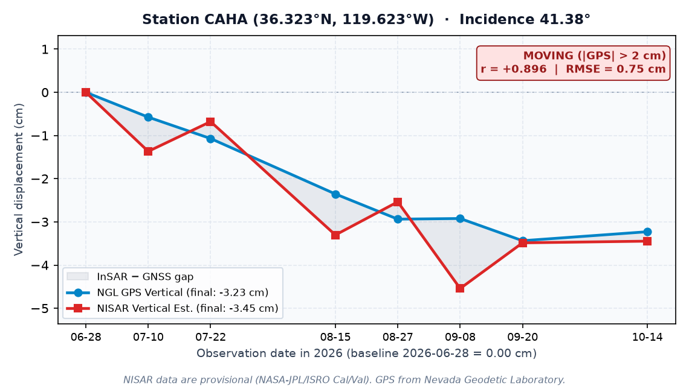

### QCAP

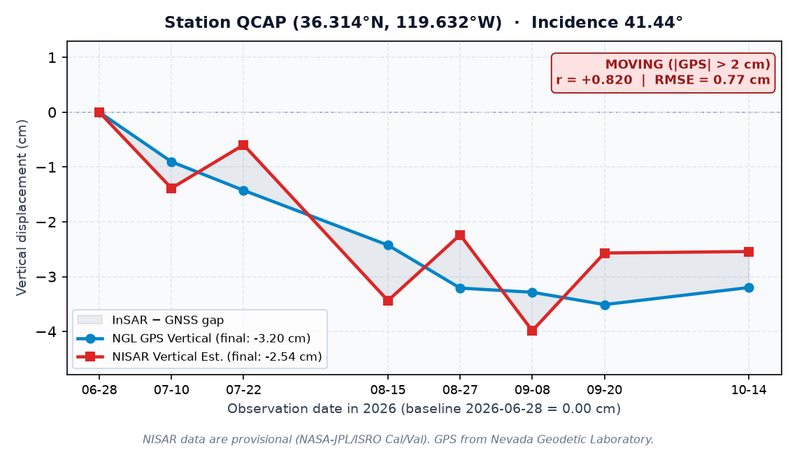

### HANF

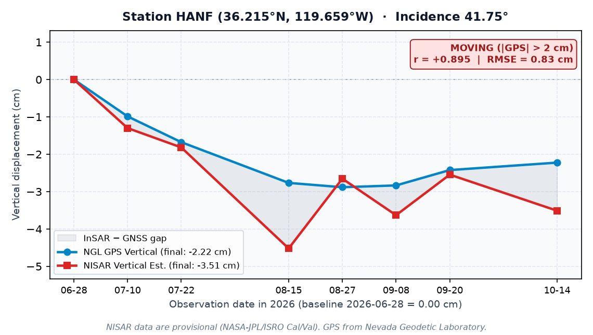

### P056

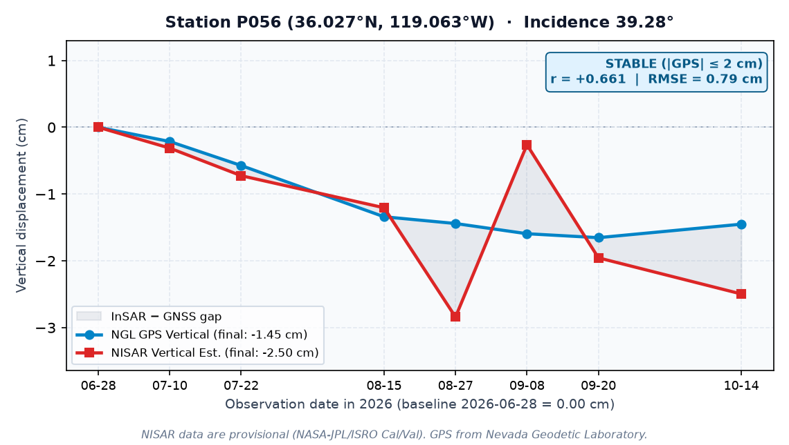

### CAFP

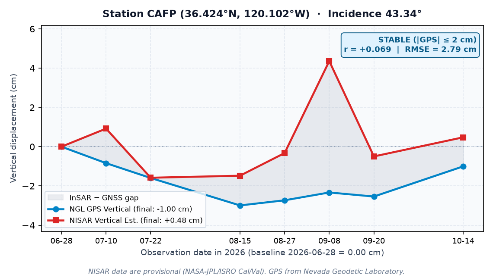

### CAD1

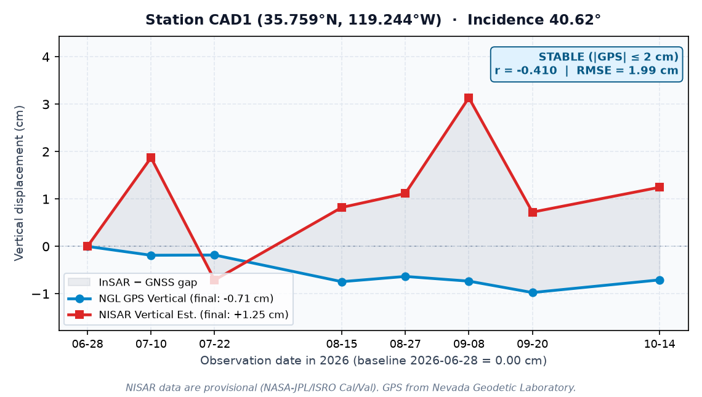

### P565

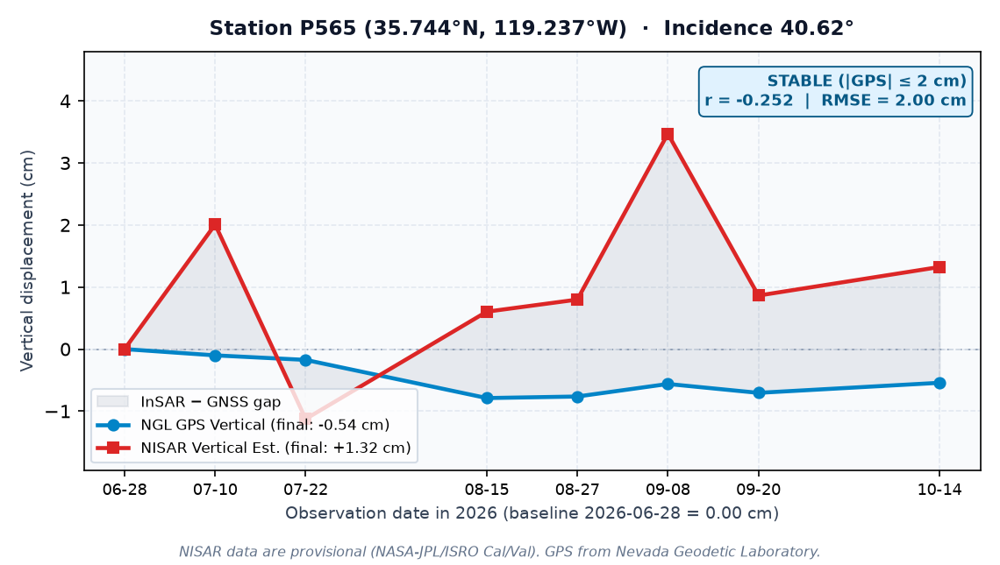

### P566

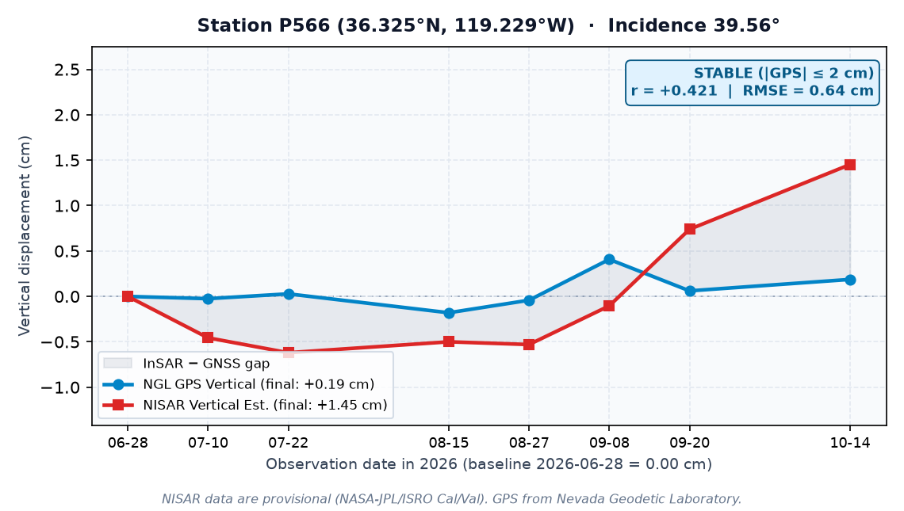

### P564

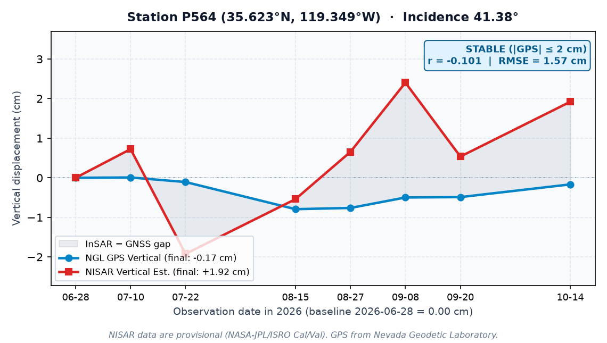
